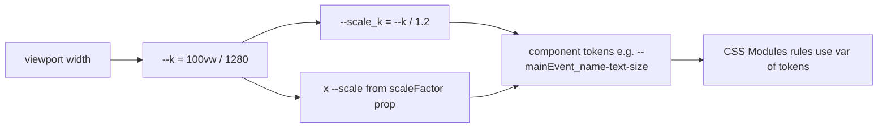
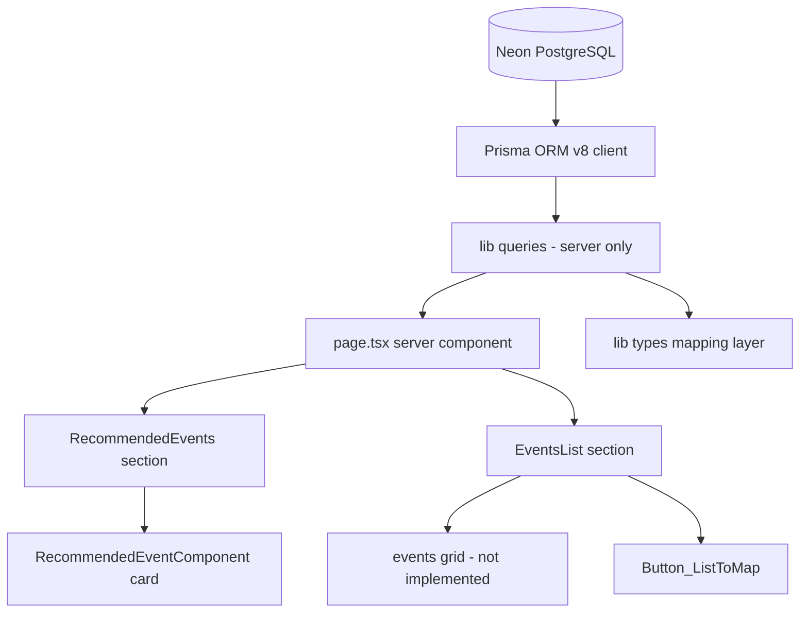

# AUDIT.md — Полный контекст проекта `project_vidoh`

> Единый входной документ для агента/разработчика, который **не знаком** с проектом.
> Прочитав этот файл целиком, можно приступать к работе без дополнительного исследования кодовой базы.
> Дата аудита: 2026-10-27. Ревизия после реструктуризации `app/(main)/` (секции → папки-компоненты `RecommendedEvents/`, `EventsList/`) и после добавления инфраструктурного слоя: Neon Postgres через Prisma ORM v8 и Backblaze B2 через AWS SDK v3. Подключения реализованы, страницами пока не используются, но **проверены на реальных кредах** (`npm run check:infra` → 0).
> Состояние: ранний прототип лендинга (UI-каркас без данных) + готовый, но не подключённый к UI слой доступа к инфраструктуре.

---

## 0. TL;DR — что это за проект

| Параметр | Значение |
|---|---|
| Название | `project_vidoh` (продуктовое имя в UI: **VDH // ВЫДОХ**, слоган «твой путь самовыражения») |
| Тип | Веб-лендинг + будущий **агрегатор мероприятий** (мастер-классы, камерные события, билеты) |
| Фреймворк | **Next.js 16.3.6** (App Router, Turbopack, typed routes) |
| UI-стек | React **19.2.8**, CSS Modules + Tailwind CSS v4 (только как утилитарный слой), SVG через SVGR |
| Язык | TypeScript 5, `strict: true`, alias `@/*` → корень проекта |
| Данные | **Prisma ORM v8**: `prisma` 8.0.0-rc.27 (CLI) + `@prisma/orm-postgres` 8.0.0-rc.20 (рантайм) → Neon Postgres. `@prisma/client` **удалён** — в v8 он не используется. Модель данных спроектирована в `__db_info/` |
| Хранилище медиа | Backblaze B2 через S3-совместимый API (`@aws-sdk/client-s3` + presigner) |
| Состояние данных | Подключения **реализованы и проверены** ([lib/db/prisma.ts](lib/db/prisma.ts), [lib/storage/s3.ts](lib/storage/s3.ts); `npm run check:infra` → код 0), но не импортируются из `app/**`; контракт [prisma/contract.prisma](prisma/contract.prisma) без доменных моделей; `.env.local` заполнен локально (в git не попадает); `lib/mock.ts` и `lib/queries.ts` **пустые** |
| Контент | Жёстко захардкожен в JSX: hero-текст — [app/(main)/page.tsx](app/%28main%29/page.tsx), карточки рекомендаций — [RecommendedEvents.tsx](app/%28main%29/RecommendedEvents/RecommendedEvents.tsx:14); изображения событий отсутствуют в `public/` |
| Язык интерфейса и документации | Русский (`<html lang="ru">`) |
| Тесты / CI | Отсутствуют |

Главный вывод: **фронтенд-каркас главной страницы готов; подключения к Neon и Backblaze B2 реализованы как «спящая» инфраструктура и подтверждены проверкой, но UI к данным не подключён.** Модель данных спроектирована в `__db_info/`; следующая задача «подключить данные» начинается с переноса модели в контракт [prisma/contract.prisma](prisma/contract.prisma), `npm run db:init` и реализации `lib/queries.ts`.

---

## 1. Быстрый старт

```bash
npm install        # postinstall выполнит prisma skills sync || exit 0
npm run dev        # next dev, http://localhost:3000
npm run build
npm run start
npm run lint       # eslint, flat config
```

Переменные окружения нужны только инфраструктурным модулям; для запуска UI они не требуются. Шаблон — [.env.example](.env.example) (в [.gitignore](.gitignore) добавлено исключение `!/.env.example`), локальные значения — `.env.local`:

| Переменная | Назначение |
|---|---|
| `DATABASE_URL` | строка подключения Neon Postgres (для рантайма — pooled endpoint `…-pooler…`) |
| `S3_ENDPOINT`, `S3_REGION` | `https://s3.<REGION>.backblazeb2.com` и регион бакета |
| `S3_BUCKET` | имя бакета |
| `S3_ACCESS_KEY_ID`, `S3_SECRET_ACCESS_KEY` | application key Backblaze |
| `S3_FORCE_PATH_STYLE` | `true` — B2 поддерживает только path-style |
| `S3_PUBLIC_BASE_URL` | опционально: база для публичных ссылок |

`dotenv` теперь объявлен в зависимостях явно и загружается и в [prisma.config.ts](prisma.config.ts), и в скрипте проверки.

Дополнительные скрипты:

```bash
npm run check:infra   # проверка Neon Postgres + Backblaze B2 (SELECT 1 и HeadBucket)
npm run db:emit       # prisma contract emit → prisma/contract.json + contract.d.ts
npm run db:init       # создать схему в базе и подписать её контрактом
npm run db:verify     # проверить соответствие базы контракту
```

Требования окружения: **Node >= 22.18** (CLI Prisma 8 RC) и **PostgreSQL >= 15** (Prisma ORM v8).

Локально `.env.local` уже заполнен (Neon + Backblaze) и в git не попадает — коммитится только [.env.example](.env.example). На этих кредах `npm run check:infra` отвечает `[OK]` для обеих инфраструктур. Драйвер `pg` при этом печатает предупреждение о том, что `sslmode=require` трактуется как `verify-full`; чтобы убрать шум, укажите в `DATABASE_URL` `sslmode=verify-full`.

### ⚠️ Обязательное правило репозитория

[AGENTS.md](AGENTS.md) (и его синоним [CLAUDE.md](CLAUDE.md), который просто содержит `@AGENTS.md`) требуют: **это не та Next.js, которая в обучающих данных**. Перед написанием любого кода нужно читать актуальные гайды в `node_modules/next/dist/docs/` и соблюдать deprecation-пометки. Блок в `AGENTS.md` автоматически перезаписывается командой `next dev` (см. `node_modules/next/dist/server/lib/generate-agent-files.js`) — не пытайтесь его «удалить», это вернёт грязный diff.

Проверенные особенности Next 16, уже использующиеся в проекте:
- глобальный тип `LayoutProps<"/">` без импорта ([app/layout.tsx](app/layout.tsx:10));
- конфигурация Turbopack-лоадеров вместо `webpack()` ([next.config.ts](next.config.ts:5));
- `next dev` и сборка работают на Turbopack, флаг `--turbopack` не нужен.

---

## 2. Структура проекта

```text
project_vidoh/
├── app/
│   ├── layout.tsx                     # корневой layout, <html lang="ru">, metadata
│   ├── fonts.ts                       # next/font/local: CodeNext (800), Onest
│   ├── globals.css                    # Tailwind import, дизайн-токены, --k, градиенты
│   ├── favicon.ico
│   └── (main)/                        # route group → URL "/"
│       ├── page.tsx                   # композиция главной: hero + <RecommendedEvents/> + <EventsList/>
│       ├── page.hero.module.css       # hero-секция: правила
│       ├── page.hero.scale.module.css # hero-секция: токены
│       ├── RecommendedEvents/         # секция «РЕКОМЕНДАЦИИ»
│       │   ├── RecommendedEvents.tsx
│       │   ├── RecommendedEvents.module.css
│       │   ├── RecommendedEvents.scale.module.css
│       │   └── RecommendedEventComponent/          # карточка события
│       │       ├── RecommendedEventComponent.tsx
│       │       ├── RecommendedEventComponent.module.css
│       │       └── RecommendedEventComponent.scale.module.css
│       └── EventsList/                # секция «Мероприятия»
│           ├── EventsList.tsx
│           ├── EventsList.module.css
│           ├── EventsList.scale.module.css
│           └── Button_ListToMap/                   # кнопка-пилюля «Картой»
│               ├── Button_ListToMap.tsx
│               └── Button_ListToMap.module.css
├── lib/
│   ├── env.ts                         # ленивая zod-валидация DATABASE_URL и S3_*
│   ├── db/
│   │   └── prisma.ts                  # клиент Prisma ORM v8, getPrisma(), disconnectPrisma()
│   ├── storage/
│   │   ├── s3.ts                      # S3Client, presigned GET/PUT, ключи объектов
│   │   └── index.ts                   # реэкспорт публичного API хранилища
│   ├── types.ts                       # доменные типы TS (Event, Location, Organizer, Category)
│   ├── mock.ts                        # ПУСТОЙ файл (0 байт)
│   └── queries.ts                     # ПУСТОЙ файл (0 байт)
├── prisma/
│   ├── contract.prisma                # контракт данных (PSL), пока без моделей
│   ├── contract.json                  # сгенерён `npm run db:emit`, коммитится
│   └── contract.d.ts                  # сгенерён `npm run db:emit`, коммитится
├── scripts/
│   └── check-connections.ts           # проверка БД и бакета, exit code 0/1
├── public/
│   ├── fonts/CodeNext-ExtraBold.woff2
│   ├── fonts/CodeNext-ExtraBoldItalic.woff2
│   ├── fonts/Onest.woff2
│   ├── icons/icon_Map.svg
│   ├── icons/icon_Pin.svg
│   └── (file|globe|next|vercel|window).svg     # дефолтные ассеты create-next-app, не используются
├── __db_info/                         # проектная документация БД (источник истины по модели данных)
│   ├── README.md                      # назначение, границы модели, домены
│   ├── schema.dbml.txt                # полная схема (DBML)
│   ├── diagram.mermaid.txt            # ER-диаграмма
│   ├── invariants.md                  # UNIQUE / составные PK / CHECK / денормализации
│   └── open-questions.md              # пробелы и план развития
├── .agents/ .claude/ .cursor/ .devin/ # skills/prisma-* — автогенерируемые копии skill-файлов
├── .moldui/                           # очередь визуальных правок инструмента moldui (+ json-батчи)
├── .idea/                             # JetBrains (проект `project_vidoh.iml`)
├── AGENTS.md / CLAUDE.md              # правила для агентов
├── next.config.ts, tsconfig.json, eslint.config.mjs, postcss.config.mjs
├── .env.example                       # шаблон переменных окружения (коммитится)
├── .env.local                         # локальные секреты (в .gitignore, в репозиторий не попадает)
├── prisma.config.ts                   # конфиг Prisma: skills.agents, orm.contract, orm.db.connection
├── package.json / package-lock.json
└── README.md                          # описание проекта: env, инфраструктура, скрипты, Prisma v8
```

Соглашения об именовании каталогов внутри `app/` (актуально после реструктуризации):
- `app/(main)/` — route group, не влияет на URL, но группирует секции главной;
- каждая секция — отдельная папка с PascalCase-именем (`RecommendedEvents/`, `EventsList/`), внутри — компонент `<Section>.tsx` и его CSS-модули; приватные папки `_*` (`_mainEvents`, `_button_ToMap`, `_favEvents`, `_eventsList`) **больше не используются**;
- вложенный компонент — подпапка с собственным именем: `RecommendedEvents/RecommendedEventComponent/`, `EventsList/Button_ListToMap/`;
- CSS-модуль называется по файлу компонента: `RecommendedEvents.module.css` рядом с `RecommendedEvents.tsx`. Исключение — hero: его стили остались рядом со страницей и названы по странице (`page.hero.module.css` / `page.hero.scale.module.css`);
- почти каждый компонент имеет **пару** CSS-файлов: `<name>.module.css` (правила, только `var(...)`) + `<name>.scale.module.css` (значения токенов). Исключение — `Button_ListToMap`: один модуль, размеры считаются инлайново через `calc(... * var(--scale))`;
- имена CSS-классов внутри модулей — camelCase (`textContainer`, `mainEventsContainer`); в TSX модули импортируются с короткими алиасами по смыслу (`hero`, `heroScale`, `fav`, `events`, `styles`, `scale`);
- импорты между компонентами — по alias `@/app/(main)/…`, а не относительными путями.

---

## 3. Карта страниц и компонентов

### Маршруты

| URL | Файл | Состояние |
|---|---|---|
| `/` | [app/(main)/page.tsx](app/%28main%29/page.tsx) | Есть, контент захардкожен |
| `/event/[slug]`, `/category/[slug]`, `/organizers/[slug]`, `/map`, auth | — | **Не существуют**, но упомянуты в типах как целевые |

### `Home` — [app/(main)/page.tsx](app/%28main%29/page.tsx)

Server Component (нет `"use client"` ни в одном файле проекта).

После реструктуризации файл стал тонкой композицией: hero остался в нём, а обе секции вынесены в отдельные компоненты.

```tsx
<main className={`flex flex-col`}>
  <div className={`${hero.main} ${heroScale.root}`}> …hero… </div>
  <RecommendedEvents/>
  <EventsList/>
</main>
```

1. **Hero** (разметка внутри `page.tsx`, стили `page.hero.module.css` + `page.hero.scale.module.css`): подзаголовок «найди своё», заголовок-градиент «ЗАНЯТИЕ ПО ДУШЕ», описание, две «кнопки» — `div`-ы с текстом «Зарегистрироваться» / «Стать исполнителем» (**не** `<button>`/`<a>`, нет обработчиков и ссылок).
2. **РЕКОМЕНДАЦИИ** — [RecommendedEvents.tsx](app/%28main%29/RecommendedEvents/RecommendedEvents.tsx): заголовок «Мероприятия, которые нельзя пропустить» + три **одинаковые** карточки `<RecommendedEventComponent .../>` с захардкоженными `date="23 окт, 19:00"`, `name="Гончарный вечер «Первая чашка»"`, `description="Слепи свою первую чашку…"`, `location="Невский проспект, 23"`, `image="/images/events/conference.jpg"`, `scaleFactor={1}`. CSS-модули импортируются как `fav` / `favScale`, классы: `main`, `textContainer`, `textTitle`, `textSubtitle`, `mainEventsContainer`.
3. **Мероприятия** — [EventsList.tsx](app/%28main%29/EventsList/EventsList.tsx): заголовок, подзаголовок, `<ButtonMap scaleFactor={2} />` и **пустой** контейнер `events.eventsContainer` (сетка событий не реализована). CSS-модули импортируются как `events` / `eventsScale`, классы: `main`, `container`, `textButtonContainer`, `textContainer`, `title`, `subtitle`, `eventsContainer` (последний в CSS не объявлен — см. §4.4).

### `RecommendedEventComponent` — [app/(main)/RecommendedEvents/RecommendedEventComponent/RecommendedEventComponent.tsx](app/%28main%29/RecommendedEvents/RecommendedEventComponent/RecommendedEventComponent.tsx)

```ts
type MainEventProps = {
  date: string;
  name: string;
  description: string;
  location: string;
  image?: string;
  scaleFactor?: number; // по умолчанию 1, прокидывается в CSS-переменную --scale
};
```

Разметка: корневой `<main>` (два абсолютно позиционированных слоя `darkRectangle` — вертикальный чёрный градиент, `purpleRectangle` — фиолетовый с `opacity: .5`), слой `.content` с датой-пилюлей, названием, описанием и локацией с иконкой `icon_Pin.svg`, плюс `.image` с `backgroundImage: url(image)`.

Импорты внутри файла: `styles` → [RecommendedEventComponent.module.css](app/%28main%29/RecommendedEvents/RecommendedEventComponent/RecommendedEventComponent.module.css), `scale` → [RecommendedEventComponent.scale.module.css](app/%28main%29/RecommendedEvents/RecommendedEventComponent/RecommendedEventComponent.scale.module.css), иконка — `import IconPin from "@/public/icons/icon_Pin.svg"`.

Замечания: используется `<main>` внутри `<main>` родителя (невалидная семантика); `.main` не имеет `position: relative`, хотя все дочерние слои — `position: absolute` (позиционируются относительно ближайшего предка, сейчас это фактически viewport/страница).

### `ButtonMap` (объявлен в файле `Button_ListToMap.tsx`) — [app/(main)/EventsList/Button_ListToMap/Button_ListToMap.tsx](app/%28main%29/EventsList/Button_ListToMap/Button_ListToMap.tsx)

`<button type="button">` с `icon_Map.svg` и текстом «Картой». Стили — [Button_ListToMap.module.css](app/%28main%29/EventsList/Button_ListToMap/Button_ListToMap.module.css), единственный модуль без `.scale`-пары: `--scale` прокидывается инлайном, а значения считаются прямо в CSS (`calc(17px * var(--scale))`). Градиентная рамка реализована приёмом `background-image: linear-gradient(#000,#000), var(--gradient_hor-YP)` + `background-clip: padding-box, border-box`. Клик не обработан, это не ссылка на карту.

---

## 4. Стилевая архитектура (самое важное для правок UI)

Проект **не** использует Tailwind-классы для геометрии/типографики. Практически вся вёрстка — CSS Modules. Tailwind подключён (`@import "tailwindcss"` в [app/globals.css](app/globals.css:1)) и используется точечно — только служебные утилиты в [app/layout.tsx](app/layout.tsx:12) (`h-full`, `min-h-full`, `flex`, `flex-col`, `antialiased`) и в корне страницы (`flex flex-col`).

### 4.1 Система пропорционального масштабирования

Основа — «дизайн-ширина» 1280 px и коэффициент от ширины вьюпорта:

```css
:root {
  --design-width: 1280;
  --k: calc(100vw / var(--design-width));
}
```

Каждый компонент объявляет в scale-модуле производный коэффициент и набор токенов размеров:

```css
/* RecommendedEvents.scale.module.css */
.root {
  --scale_k: calc(var(--k) / 1.2);
  --textTitle_text-size: calc(56 * var(--scale_k));
  --main_gap: calc(23 * var(--scale_k));
}
```

Смысл: все размеры «в пикселях макета» умножаются на `--k` (или `--k / 1.2`), поэтому вёрстка линейно масштабируется вместе с шириной окна. Компоненты с вариативным размером дополнительно умножают на `--scale` (проп `scaleFactor`): `calc(var(--k) / 1.2 * var(--scale))` в [RecommendedEventComponent.scale.module.css](app/%28main%29/RecommendedEvents/RecommendedEventComponent/RecommendedEventComponent.scale.module.css:3).



Схема применения в JSX — оба модуля на одном элементе, чтобы токены каскадом дошли до правил:

```tsx
<div className={`${hero.main} ${heroScale.root}`}> ... </div>
<main className={`${styles.main} ${scale.root}`} style={{ "--scale": scaleFactor } as React.CSSProperties}>
```

### 4.2 Дизайн-токены — [app/globals.css](app/globals.css)

Цвета:

| Токен | Значение | Роль |
|---|---|---|
| `--color_black-graphite` | `#1B1B1B` | основной тёмный фон (по макету) |
| `--color_purple-haze` | `#988FFC` | акцент 1 (фиолетовый) |
| `--color_lemon-zest` | `#E0FC88` | акцент 2 (лайм) |
| `--color_flowered-white` | `#F4F4F4` | основной светлый текст |
| `--color_black` / `--color_secondary-black` / `--color_secondary-white` | `#000000` / `#515151` / `#9E9E9E` | нейтральные уровни |
| `--gradient_hor-PY` / `-YP` / `-PYP` / `-YPY` | фиолетовый ↔ лайм, горизонтально | заголовки, рамки |
| `--gradient_ver-PY` / `-YP` / `-PYP` / `-YPY` / `-Pt` / `-Bt` | вертикальные, `-Pt`/`-Bt` — затухание в прозрачность/чёрный | оверлеи карточек |

Соглашение об именах: `<назначение>_<свойство>-<уточнение>` (`--main_padding-topBottom`, `--textTitle_text-size`). Значения — только в `*.scale.module.css`; в `*.module.css` — только `var(...)`.

Градиентный текст реализуется через `background: var(--gradient_...)` + `background-clip: text` + `-webkit-text-fill-color: transparent` (+ `padding-right: 4px` — фикс обрезки курсивной буквы). Шрифты: `--font-codenext` (CodeNext ExtraBold 800, курсив — заголовки) и `--font-onest` (Onest, тексты/кнопки).

### 4.3 Шрифты — [app/fonts.ts](app/fonts.ts)

`next/font/local`: `codeNext` (2 начертания 800: normal + italic, `variable: '--font-codenext'`), `onest` (1 файл, `variable: '--font-onest'`).

Потенциальная проблема: в [app/globals.css](app/globals.css:35) блок `@theme inline` объявляет `--font-codenext: 'CodeNext', sans-serif` и `--font-onest: 'Onest', sans-serif` — то есть **литеральные имена семейств**, а не `var(--font-codenext)`. `next/font/local` генерирует хешированное имя семейства, поэтому рендер может уйти на системный fallback. Также в [app/layout.tsx](app/layout.tsx:12) на `<html>` навешен только `codeNext.variable`; `onest.variable` не применяется нигде. Проверить визуально при первой правке типографики; канонический фикс — `--font-codenext: var(--font-codenext)` недопустим (цикл), правильный — использовать имена переменных, которые отдаёт `next/font`, и добавить оба `.variable` на `<html>`.

### 4.4 CSS-файлы по секциям

| Файл | Что задаёт |
|---|---|
| [page.hero.module.css](app/%28main%29/page.hero.module.css) | Hero: секция 100vh, `background-color: white`, колонка по центру; заголовок 60px-токен с горизонтальным градиентом PYP; две половины для кнопок |
| [page.hero.scale.module.css](app/%28main%29/page.hero.scale.module.css) | `--main-page_*` токены (gap 49, title 60, subtitle 32, description 14/516, кнопки) |
| [RecommendedEvents.module.css](app/%28main%29/RecommendedEvents/RecommendedEvents.module.css) | Секция рекомендаций: паддинги, вертикальный градиент фиолетового 15%→0% (`--main_background-color`), `overflow: hidden` |
| [RecommendedEvents.scale.module.css](app/%28main%29/RecommendedEvents/RecommendedEvents.scale.module.css) | `--scale_k`; токены: title 56 + `drop-shadow` фиолетовым, subtitle 20, gap карточек 55 |
| [EventsList.module.css](app/%28main%29/EventsList/EventsList.module.css) | Секция мероприятий: контейнер 50% ширины, центрирование через `left: 50%` + `translate(-50%, 0)`, `align-items: flex-end` для строки заголовок+кнопка |
| [EventsList.scale.module.css](app/%28main%29/EventsList/EventsList.scale.module.css) | `--scale_k`; токены: title 24, subtitle 14, отступы |
| [RecommendedEventComponent.module.css](app/%28main%29/RecommendedEvents/RecommendedEventComponent/RecommendedEventComponent.module.css) | Карточка 580×232 (токены), `border-radius: 12px`, `overflow: hidden`, `drop-shadow` фиолетовым 30% + `inset box-shadow` 50%; оверлеи `darkRectangle`/`purpleRectangle` |
| [RecommendedEventComponent.scale.module.css](app/%28main%29/RecommendedEvents/RecommendedEventComponent/RecommendedEventComponent.scale.module.css) | `--scale` + `--main-page_k`; дата 9px, имя 25px (лайм, курсив), описание 10px, иконка 9×12, `content-top` 128 |
| [Button_ListToMap.module.css](app/%28main%29/EventsList/Button_ListToMap/Button_ListToMap.module.css) | Пилюля с градиентной рамкой, иконка 17px, текст Onest 12px; единственный модуль без `.scale`-пары |

Замеченные несогласованности (не блокеры, но при правках учитывать):
- в `page.hero.scale.module.css` медиа-запросы переопределяют `--scale_k`, но токены секции считаются от `--main-page_k` → **медиа-запросы фактически ни на что не влияют**;
- в одном проекте параллельно живут два имени коэффициента (`--scale_k` в `RecommendedEvents`/`EventsList`, `--main-page_k` в hero и карточке) при одинаковом значении `--k / 1.2`;
- в [EventsList.tsx](app/%28main%29/EventsList/EventsList.tsx:17) используется `className={events.eventsContainer}`, но класс `.eventsContainer` **отсутствует** в [EventsList.module.css](app/%28main%29/EventsList/EventsList.module.css) → в рантайме `className` получает `undefined`;
- накопились неиспользуемые токены: `--main_width`, `--main_height`, `--mainEventsContainer-top`, `--textContainer-top` (`RecommendedEvents.scale.module.css`), `--textButtonContainer_gap` (`EventsList.scale.module.css`), `--mainEvent_name-text-width` (карточка);
- `.main` карточки не `position: relative` при абсолютных дочерних слоях;
- hero-секция имеет белый фон, а текст в ней — `--color_flowered-white` (#F4F4F4) → контраст почти нулевой. По дизайну фон должен быть тёмным (`--color_black-graphite`), вероятно потерян слой/фоновое изображение.

---

## 5. Слой данных: текущее и проектное состояние

### 5.1 Что есть сейчас

**Инфраструктурный слой есть, использования нет** (ни один модуль не импортируется из `app/**`):

- [lib/env.ts](lib/env.ts) — `getDbEnv()` / `getS3Env()` на `zod`; ленивая валидация, мемоизация, ошибка со списком незаполненных переменных.
- [lib/db/prisma.ts](lib/db/prisma.ts) — `contractFromJson<Contract>()` + `postgres({ contract, url })`; `getPrisma()` (кэш в `globalThis`), `createPrismaClient({ verifyMarker })`, `connectPrisma()`, `disconnectPrisma()`. Пул создаётся при первом запросе.
- [lib/storage/s3.ts](lib/storage/s3.ts) — ленивый `S3Client` (`forcePathStyle`, endpoint из env), `getPresignedGetUrl()`, `getPresignedPutUrl()`, `getPublicUrl()`, `buildObjectKey()`; [lib/storage/index.ts](lib/storage/index.ts) — реэкспорт.
- [scripts/check-connections.ts](scripts/check-connections.ts) — `npm run check:infra`: `select 1` + `server_version` и `HeadBucket` (с фолбэком на `ListObjectsV2`), exit code 0/1.

Ниже — то, чего ещё нет:

- [lib/types.ts](lib/types.ts) — типизированная доменная модель **для будущего слоя запросов** (никем не импортируется).
- [lib/mock.ts](lib/mock.ts) и [lib/queries.ts](lib/queries.ts) — пустые файлы: слой запросов не написан.
- Контракт [prisma/contract.prisma](prisma/contract.prisma) описывает **пустую схему** (только подключение); доменные модели из `__db_info/schema.dbml.txt` не перенесены.
- ORM-запросы к базе требуют «подписи» контрактом (`npm run db:init`): до этого обычный запрос падает с `CONTRACT.MARKER_READ_FAILED` (поэтому в проверочном скрипте стоит `verifyMarker: false`).

Данные для карточек сейчас физически находятся в JSX [RecommendedEvents.tsx](app/%28main%29/RecommendedEvents/RecommendedEvents.tsx:14) (три идентичные карточки), тексты hero — в [page.tsx](app/%28main%29/page.tsx:10).

### 5.2 `lib/types.ts` — доменные типы

`EventStatus = "draft" | "published" | "cancelled"`; `Coordinates { lat, lng }`; `Location { id, name, address, city?, coordinates }`; `Organizer { id, slug, name, bio, avatar }`; `Category { id, slug, title }`; `Event { id, slug, title, shortDescription, fullDescription, startsAt, endsAt, location, organizers[], coverImage, gallery[], isFree, price, currency, category, tags[], status, createdAt, updatedAt }`; `EventCardData` — проекция для карточек (без `fullDescription`/`gallery`, `location` урезан до `name|address`, организаторы до `id|name|avatar`). Хелперы: `isPast(event)` (сравнение `endsAt` с `Date.now()`), `isCancelled(event)`.

Комментарий в шапке файла: «"past" НЕ хранится в БД — вычисляется из endsAt < now».

### 5.3 `__db_info/` — спроектированная БД (источник истины по модели)

Назначение: агрегатор мероприятий. Пользователи ищут события, покупают билеты, оставляют отзывы, добавляют в избранное. Организаторы — **внешние** физлица/юрлица, **не связанные с `users`**. Модератор (`roles.code = 'moderator'`) — единственный, кто правит события, цены, `utc_offset`, юридические документы.

Домены и таблицы:

| Домен | Таблицы |
|---|---|
| Users & Auth | `users`, `roles`, `user_roles`, `user_sessions` |
| Organizers | `organizers` (+ `organizer_media`) |
| Geography | `countries` → `cities` → `venues` |
| Categories | `categories` (самоссылка `parent_id`) + `category_media` |
| Media | `media` (единая библиотека: `image|video|doc`) + связки `event_media`, `organizer_media`, `category_media` |
| Events | `events`, `event_sessions`, `event_organizers`, `event_categories`, `event_links`, `event_legal_documents` |
| Tickets | `tickets` (одна цена на тип; `session_id` опционален) |
| Promo | `promo_codes` (`percent|fixed`) |
| Interactions | `user_favorites`, `event_reviews` (rating 1..5, один отзыв на юзера на событие) |
| Orders | `orders`, `order_items` (со снапшотами названий), `issued_tickets` (QR-код), `payments` |

ENUM-типы: `user_status`, `organizer_status`, `organizer_legal_form`, `event_status` (`draft|published|postponed|cancelled|finished|archived`), `media_role`, `link_type`, `legal_document_type`, `review_status`, `order_status`, `ticket_status`, `promo_discount_type`.

Ключевые правила (из [__db_info/invariants.md](__db_info/invariants.md)):
- время — `timestamptz` в UTC, отображение через `events.utc_offset` / `event_sessions.utc_offset` (строка `±HH:MM`, задаётся модератором вручную, **не** выводится из локации; у `cities`/`venues` таймзоны нет намеренно);
- CHECK: `events.end_at > start_at`; `events.venue_id IS NOT NULL OR events.online_url IS NOT NULL`; `tickets.price >= 0`; `order_items.quantity > 0`; координаты в пределах полушарий; `utc_offset ~ '^[+-]\d{2}:\d{2}$'`;
- частичные UNIQUE: один `media_role = 'main'` на событие, один `is_primary = true` в `event_organizers` и `event_categories`, один отзыв `(event_id, user_id)`;
- денормализации: `events.is_free` ← `tickets.price`, `tickets.sold_count` ← `issued_tickets` (пересчёт триггером/outbox — **не реализовано**);
- запрещено: массивы URL в колонке, несколько цен в одном типе билета, timezone на city/venue, теги и подписки (исключены намеренно).

Диаграмма связей — [__db_info/diagram.mermaid.txt](__db_info/diagram.mermaid.txt), полная схема — [__db_info/schema.dbml.txt](__db_info/schema.dbml.txt).

### 5.4 Расхождения `lib/types.ts` ↔ `__db_info` (важно перед реализацией)

| Где | `lib/types.ts` | БД |
|---|---|---|
| Статусы события | 3 значения (`draft|published|cancelled`) | 6 значений (`+postponed|finished|archived`) |
| Цена | `Event.price: number \| null`, `currency` на событии | цена в `tickets.price`, валюта и там, и в `events.currency` |
| Теги | `Event.tags: string[]` | намеренно исключены |
| Время | `startsAt`/`endsAt` ISO-строки с оффсетом | `start_at`/`end_at` UTC + отдельный `utc_offset` |
| Локация | `Location.address` обязателен, `coordinates` обязательны, `city?` | `venues` (address/metro/lat/lng nullable) + `cities`; у события `venue_id` nullable для онлайна |
| Организатор | `bio`, `avatar` | `short_description` + `description`, аватар через `media` |
| Категории | одна `category` (primary) | N:N `event_categories` с `is_primary` |
| Изображения | `coverImage: string`, `gallery: string[]` | `event_media` + `media` (роли `main`/`gallery`) |
| Отсутствует в типах | — | `event_sessions`, `event_links`, `event_legal_documents`, `promo_codes`, `user_favorites`, `event_reviews`, `orders`, `order_items`, `issued_tickets`, `payments`, `users`, роли |

Вывод: `lib/types.ts` — это **упрощённая UI-модель для карточек**, а не зеркало БД. При реализации запросов нужно либо маппить Prisma-результаты в эти типы, либо расширять типы (предпочтительно — маппинг, чтобы не протекали детали БД в UI).

### 5.5 Целевой поток данных



Текущий поток: `page.tsx` (hero) → `RecommendedEvents.tsx` (литералы трёх карточек) → `RecommendedEventComponent`; отдельная ветка `EventsList.tsx` → `Button_ListToMap`. `lib/*` и `__db_info/*` в рантайме не участвуют.

Инфраструктурные модули ([lib/db](lib/db/prisma.ts), [lib/storage](lib/storage/s3.ts)) в этом потоке отсутствуют: они готовы к подключению, но страницами не импортируются. Ветка S3 появится вместе с загрузкой медиа (`getPresignedPutUrl` / `getPublicUrl`), ветка БД — с `lib/queries.ts`.

---

## 6. Зависимости: что установлено и что реально используется

| Пакет | Версия (фактически в `node_modules`) | Используется |
|---|---|---|
| `next` | 16.3.6 | Да — App Router, Turbopack, `next/font/local` |
| `react` / `react-dom` | 19.2.8 | Да |
| `typescript` | 5.x | Да |
| `tailwindcss` + `@tailwindcss/postcss` | 4.x | Частично: `@import "tailwindcss"` + несколько утилит |
| `@svgr/webpack` | 8.x | Да — через `turbopack.rules` в [next.config.ts](next.config.ts:5); импорт `import Icon from "@/public/icons/x.svg"` |
| `prisma` (CLI) | 8.0.0-rc.27 | Да — `prisma contract emit`, `db init/verify`, `skills sync` в `postinstall` |
| `@prisma/orm-postgres` | 8.0.0-rc.20 | Да — рантайм-клиент в [lib/db/prisma.ts](lib/db/prisma.ts); приносит `pg`, `@prisma/orm-toolchain` и др. |
| `@prisma/client` | **удалён** | В Prisma ORM v8 не используется (заменён на `@prisma/orm-postgres`) |
| `@aws-sdk/client-s3` + `@aws-sdk/s3-request-presigner` | 3.1157.x | Да — [lib/storage/s3.ts](lib/storage/s3.ts) |
| `zod` | 4.6.7 | Да — валидация env в [lib/env.ts](lib/env.ts) |
| `dotenv` | 18.0.9 | Да — [prisma.config.ts](prisma.config.ts), [scripts/check-connections.ts](scripts/check-connections.ts) |
| `tsx` (dev) | 4.23.x | Да — запуск `scripts/check-connections.ts` |
| `temporal-polyfill` | 1.0.x | Транзитивно требуется `@prisma/orm-postgres` (peer) |
| `pg` | 8.22 (транзитивно) | Драйвер внутри `@prisma/orm-postgres`; напрямую не импортируется, но его сообщения видны в выводе проверки |
| `eslint` + `eslint-config-next` | 9.x / 16.3.6 | Да — `npm run lint`; сгенерированный `prisma/contract.d.ts` в игноре |

Замечание: версии `prisma` и `@prisma/orm-postgres` **нужно обновлять парой** — `contract emit` работает только когда `@prisma/cli-engine` у CLI совпадает с версией, которую ожидает `@prisma/orm-toolchain` внутри `@prisma/orm-postgres`. Проверено: rc.17 CLI + rc.20 рантайм падает на `Invalid authoring type constructor "Raw"`; рабочая пара — rc.27 + rc.20.

---

## 7. Инструментарий агентов и окружение

- [AGENTS.md](AGENTS.md) — правила Next 16 (см. §1). [CLAUDE.md](CLAUDE.md) — одна строка `@AGENTS.md` (импорт).
- `.agents/skills/prisma-composer-core-concepts/`, `.agents/skills/prisma-platform-core-concepts/` и их зеркала в `.claude/`, `.cursor/`, `.devin/` — **автогенерируемые** командой `prisma skills sync` (список агентов задан в [prisma.config.ts](prisma.config.ts:5)). Это документация Prisma Platform/Composer, к домену проекта отношения не имеет; править вручную бессмысленно.
- `.moldui/` — буфер визуальных правок инструмента moldui + json-батчи; применяется командой `/moldui-sync` в Claude Code.
- `.idea/` — JetBrains-проект (`project_vidoh.iml` в корне).
- `.env*` в `.gitignore` → секреты не коммитятся; исключение — `.env.example` (шаблон). Локально `.env.local` заполнен и содержит реальные креды Neon/Backblaze.

---

## 8. Ассеты

Есть: три шрифта в `public/fonts/` (CodeNext ExtraBold normal/italic, Onest), две иконки в `public/icons/` (`icon_Pin.svg`, `icon_Map.svg`), дефолтные Next-ассеты (не используются, можно удалить), `app/favicon.ico`.

**Отсутствует:** каталог `public/images/` — при этом страница ссылается на `/images/events/conference.jpg`. То есть фон карточек сейчас пустой (404). Нужен либо сид медиафайлов, либо заглушка.

---

## 9. Известные проблемы и техдолг (по убыванию важности)

1. **Контракт пустой**: [prisma/contract.prisma](prisma/contract.prisma) описывает только подключение, доменных моделей нет. Модель существует как DBML в [__db_info/schema.dbml.txt](__db_info/schema.dbml.txt) — её нужно перенести в контракт и выполнить `npm run db:emit`.
2. **Секреты только локально**: `.env.local` заполнен на машине разработчика и в git не попадает, поэтому в CI нужны собственные значения (иначе `npm run check:infra` упадёт на валидации env). Проверено вручную: Postgres отвечает (`server_version` 18.6, база `VDH`, pooled endpoint), бакет `vdh-storage` в регионе `eu-central-003` доступен через `HeadBucket`.
3. **Версии Prisma связаны парой**: `prisma` 8.0.0-rc.27 ↔ `@prisma/orm-postgres` 8.0.0-rc.20. Обновлять только вместе: несовпадение `@prisma/cli-engine` ломает `contract emit` (`Invalid authoring type constructor "Raw"`).
4. **Пустые `lib/mock.ts` и `lib/queries.ts`**; `lib/types.ts` не используется — контент захардкожен: три идентичные карточки в [RecommendedEvents.tsx](app/%28main%29/RecommendedEvents/RecommendedEvents.tsx:14), тексты hero в [page.tsx](app/%28main%29/page.tsx:10).
5. **Сетка мероприятий пустая и сломана**: в [EventsList.tsx](app/%28main%29/EventsList/EventsList.tsx:17) рендерится `div` с `className={events.eventsContainer}`, но класса `.eventsContainer` нет в `EventsList.module.css` → `className` равен `undefined`; кнопка «Картой» и два hero-CTA не имеют ни ссылок, ни обработчиков — интерактив отсутствует полностью.
6. **`public/images` отсутствует** → 404 на `/images/events/conference.jpg`.
7. **SVG-импорты**: своих `declare module "*.svg"` в проекте нет — типы приходят из `next/image-types/global` через `next-env.d.ts`, поэтому `import IconPin from "@/public/icons/icon_Pin.svg"` проходит и `next build` зелёный. Ограничение: такой импорт работает только внутри Next-сборки, в отдельном `tsx`-скрипте SVG надо читать как файл.
8. **Контраст hero**: белый фон секции + почти белый текст; по дизайну должен быть тёмный фон.
9. **Типографика шрифтов**: `@theme inline` задаёт литеральные имена семейств вместо переменных `next/font`; `onest.variable` не навешен на `<html>`.
10. **Семантика/позиционирование**: вложенные `<main>` (`RecommendedEventComponent` рендерит `<main>` внутри `<main>` страницы); `.main` карточки без `position: relative`; CTA реализованы как `div`.
11. **Неэффективные медиа-запросы** в `page.hero.scale.module.css` (переопределяют неиспользуемый `--scale_k`).
12. **Дублирование и мусор в токенах**: два имени коэффициента (`--scale_k` / `--main-page_k`), плюс неиспользуемые токены в scale-модулях (перечислены в §4.4).
13. **Контракт и DBML пока не синхронизированы**: доменная модель живёт только в [__db_info/schema.dbml.txt](__db_info/schema.dbml.txt), а [prisma/contract.prisma](prisma/contract.prisma) пуст — расхождение будет расти, пока модели не перенесены.
14. Нет тестов, нет CI/CD, нет линт-гейта на pre-commit.

Бэкенд-пробелы, уже зафиксированные в [__db_info/open-questions.md](__db_info/open-questions.md): нет резервирования мест (риск оверселлинга), нет идемпотентности заказов/платежей, нет триггера пересчёта `is_free`, нет снапшота `utc_offset` в заказе, нет внешних источников/дедупликации импорта, нет модерации и `audit_log`, нет уведомлений/outbox, нет refund-процесса, нет `user_consents`, нет полнотекстового и гео-поиска, нет seat maps.

---

## 10. Рекомендуемый порядок работ

1. Перенести `__db_info/schema.dbml.txt` → [prisma/contract.prisma](prisma/contract.prisma) (модели, enum, индексы, `@@map` в snake_case), выполнить `npm run db:emit`, затем `npm run db:init` и `npm run db:verify` на базе Neon.
2. Заполнить `.env.local` по [.env.example](.env.example) (Neon + Backblaze) и прогнать `npm run check:infra` как smoke-тест инфраструктуры.
3. Слой доступа к данным уже есть: [lib/db/prisma.ts](lib/db/prisma.ts) (`getPrisma()`) и [lib/env.ts](lib/env.ts). Осталось добавить `lib/queries.ts` с реальными выборками и импортировать его только из server-компонентов.
4. Реализовать `lib/queries.ts`: выборки под главную (`recommendedEvents`, `upcomingEvents`), возвращающие `EventCardData`; маппинг Prisma → `lib/types.ts`.
5. Заменить хардкод на данные из queries: карточки — в [RecommendedEvents.tsx](app/%28main%29/RecommendedEvents/RecommendedEvents.tsx), hero-текст — в [page.tsx](app/%28main%29/page.tsx); сетку событий рендерить в [EventsList.tsx](app/%28main%29/EventsList/EventsList.tsx) (сначала объявить класс `.eventsContainer` в [EventsList.module.css](app/%28main%29/EventsList/EventsList.module.css)); обработать пустое состояние.
6. Расширить `EventStatus` до 6 значений БД (или ввести отдельный UI-статус), синхронизировать `Location`/`Organizer`/цены с реальной схемой.
7. Добавить ассеты событий (`public/images/events/…`) либо перейти на `next/image` + URL из `media`.
8. Починить стилевые дефекты §9.8–9.12 (фон hero, шрифты, `position: relative`, медиа-запросы, единый коэффициент) и объявить отсутствующий класс `.eventsContainer`.
9. Создать маршруты: `/event/[slug]`, `/category/[slug]`, `/organizers/[slug]`, `/map`, страницы авторизации.
10. Минимальный интерактив: hero-CTA как ссылки, «Картой» → `/map`, карточки → `/event/[slug]`.
11. Добавить в CI проверки: `npm run build` (включает TypeScript), `npm run lint`, `npm run check:infra` как smoke-тест инфраструктуры (нужны секреты) и хотя бы минимальные тесты.

---

## 11. Чеклист для нового агента (перед первой правкой)

- [ ] Прочитать [AGENTS.md](AGENTS.md) и нужный гайд из `node_modules/next/dist/docs/` — версия Next 16 отличается от привычной.
- [ ] Не импортировать [lib/db/prisma.ts](lib/db/prisma.ts) и [lib/storage/s3.ts](lib/storage/s3.ts) в клиентские компоненты: они рассчитаны на server-код и читают env лениво. Секреты — только в `.env.local` (в git попадает лишь `.env.example`).
- [ ] Prisma здесь — ORM v8: контракт в `prisma/contract.prisma`, артефакты генерирует `npm run db:emit`; `@prisma/client` и `prisma/schema.prisma` в проекте отсутствуют намеренно.
- [ ] Понять пару «`*.module.css` + `*.scale.module.css`»: правила — в первом, числовые значения — только во втором, размеры всегда через `--k` (или `calc(... * var(--k) / 1.2)`).
- [ ] Не добавлять Tailwind-классы для размеров/типографики — в проекте это делают токены.
- [ ] Не хардкодить контент в компонентах — данные должны приходить из `lib/queries.ts` (после его реализации).
- [ ] Не менять `__db_info/*` без явного запроса: это согласованный дизайн БД, трогать только вместе с реализацией.
- [ ] Не редактировать `AGENTS.md`, `.agents/.claude/.cursor/.devin/skills` — генерируется автоматически.
- [ ] Новую секцию держать в папке-компоненте: `app/(main)/<Section>/<Section>.tsx` + `<Section>.module.css` + `<Section>.scale.module.css`; вложенные компоненты — в подпапках `<Section>/<Child>/<Child>.tsx`. Файлы-компоненты — PascalCase, CSS-классы — camelCase, импорты между компонентами — через `@/app/(main)/…`.
- [ ] Язык UI-текстов — русский; `<html lang="ru">` менять не нужно.
- [ ] Server Components по умолчанию; `"use client"` добавлять только при реальной интерактивности.

---

## 12. Глоссарий

| Термин | Значение |
|---|---|
| `fav` | исторический алиас импорта CSS-модуля секции РЕКОМЕНДАЦИИ: в [RecommendedEvents.tsx](app/%28main%29/RecommendedEvents/RecommendedEvents.tsx) модули импортируются как `fav` / `favScale`. Файлы после реструктуризации названы `RecommendedEvents.*`, алиас остался. Не путать с «избранным» пользователя |
| `events` | 1) блок «Мероприятия» — каталог/сетка на главной; 2) алиас импорта CSS-модуля этой секции в [EventsList.tsx](app/%28main%29/EventsList/EventsList.tsx) (`events` / `eventsScale`) |
| `hero` | первый экран главной |
| `scaleFactor` / `--scale` | множитель размера компонента (например, карточка в 2 раза крупнее) |
| `--k` | коэффициент `100vw / 1280`, база пропорционального масштабирования |
| контракт (Prisma ORM v8) | PSL-описание модели в `prisma/contract.prisma`; артефакты `contract.json` / `contract.d.ts` генерирует `npm run db:emit` |
| маркер контракта | служебная запись в БД, которой база «подписывается» под контракт (`npm run db:init`); без неё обычный ORM-запрос падает с `CONTRACT.MARKER_READ_FAILED` |
| `verifyMarker` | опция клиента: `'onFirstUse'` (по умолчанию) или `false` — проверка маркера отключена (используется в `check:infra`) |
| pooled endpoint | хост Neon с суффиксом `-pooler` (PgBouncer); используется в рантайме, для миграций удобнее direct-хост |
| presigned URL | подписанный на время URL объекта в S3 (`getPresignedGetUrl` / `getPresignedPutUrl`), доступен без публичного бакета |
| `utc_offset` | строка `±HH:MM`, задаваемая модератором; единственный источник отображения времени |
| «модератор» | роль `moderator` в `user_roles`; правит события, цены, `utc_offset`, юр. документы |
| «организатор» | отдельная сущность `organizers`, не связанная с `users` |
