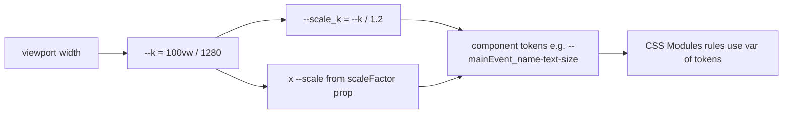
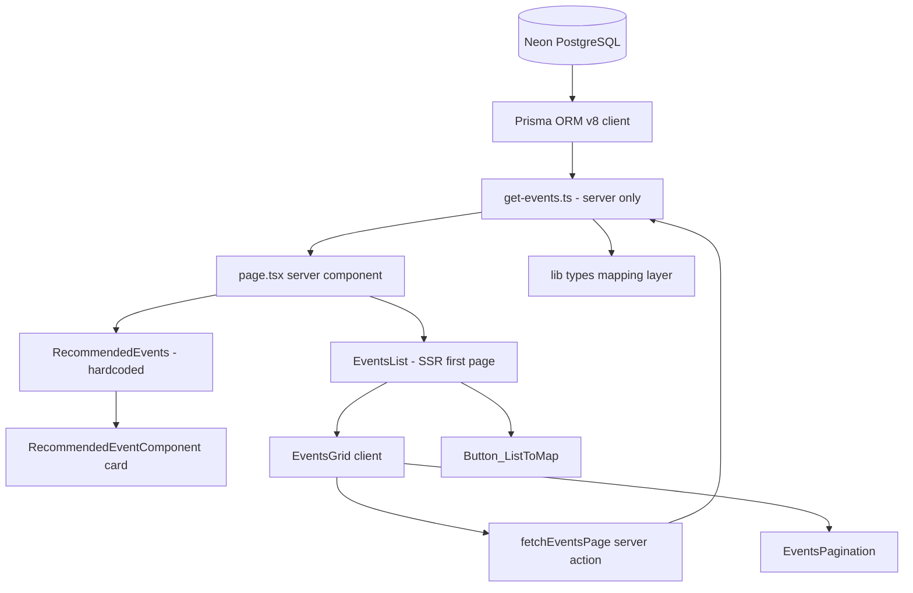

# AUDIT.md — Полный контекст проекта `project_vidoh`

> Единый входной документ для агента/разработчика, который **не знаком** с проектом.
> Прочитав этот файл целиком, можно приступать к работе без дополнительного исследования кодовой базы.
> Дата аудита: 2026-10-27, обновлён после подключения секции «Мероприятия» к БД (raw-выборка + клиентская пагинация без навигации) и появления демо-данных. Предыдущие ревизии: консолидация документации БД в `__db_info/schema.dbml` + `schema.sql`; реструктуризация `app/(main)/`; инфраструктурный слой — Neon Postgres (Prisma ORM v8) и Backblaze B2 (AWS SDK v3), проверен `npm run check:infra` → 0.
> Состояние: работающий прототип главной — hero и рекомендации на литералах, **афиша читает БД** (12 демо-событий через `npm run seed:demo`), схема в Neon развёрнута (25 таблиц, 15 enum-типов, `citext`); контракт Prisma пока пуст.

---

## 0. TL;DR — что это за проект

| Параметр | Значение |
|---|---|
| Название | `project_vidoh` (продуктовое имя в UI: **VDH // ВЫДОХ**, слоган «твой путь самовыражения») |
| Тип | Веб-лендинг + будущий **агрегатор мероприятий** (мастер-классы, камерные события, билеты) |
| Фреймворк | **Next.js 16.3.6** (App Router, Turbopack, typed routes) |
| UI-стек | React **19.2.8**, CSS Modules + Tailwind CSS v4 (только как утилитарный слой), SVG через SVGR |
| Язык | TypeScript 5, `strict: true`, alias `@/*` → корень проекта |
| Данные | **Prisma ORM v8**: `prisma` 8.0.0-rc.27 (CLI) + `@prisma/orm-postgres` 8.0.0-rc.20 (рантайм) → Neon Postgres. `@prisma/client` **удалён** — в v8 он не используется. Схема БД — [__db_info/schema.dbml](__db_info/schema.dbml) и [__db_info/schema.sql](__db_info/schema.sql) |
| Хранилище медиа | Backblaze B2 через S3-совместимый API (`@aws-sdk/client-s3` + presigner); в схеме метаданные файлов — таблица `media` (`storage_key` + `url`) |
| Состояние данных | Схема в Neon развёрнута (25 таблиц, 15 enum-типов, `citext`). Данные — только демо: 12 событий (`slug demo-*`), 3 площадки, 1 медиа-заглушка; включаются/выключаются `npm run seed:demo` / `npm run seed:demo:clear`. БД **используется в UI**: [get-events.ts](app/(main)/EventsList/get-events.ts) → [lib/db/prisma.ts](lib/db/prisma.ts) (raw-лейн). [lib/storage/s3.ts](lib/storage/s3.ts) пока не используется. Контракт [prisma/contract.prisma](prisma/contract.prisma) **пуст**; `lib/mock.ts` и `lib/queries.ts` пустые |
| Контент | Секция «Мероприятия» **читает БД** ([get-events.ts](app/(main)/EventsList/get-events.ts)); hero-текст и карточки рекомендаций пока захардкожены ([page.tsx](app/%28main%29/page.tsx), [RecommendedEvents.tsx](app/%28main%29/RecommendedEvents/RecommendedEvents.tsx:14)). Обложки — `media.url`; для демо засеяна локальная заглушка [public/images/events/placeholder.svg](public/images/events/placeholder.svg) |
| Язык интерфейса и документации | Русский (`<html lang="ru">`) |
| Тесты / CI | Отсутствуют |

Главный вывод: **секция «Мероприятия» работает на реальных данных из Neon (пагинация без навигации), но общий слой запросов не выделен, контракт Prisma пуст, а hero и рекомендации всё ещё на литералах.** Ближайшие шаги: контракт из БД (блокер — тип `citext` в `users.email`), страница `/event/[slug]`, перевод рекомендаций на данные.

---

## 1. Быстрый старт

```bash
npm install        # postinstall выполнит prisma skills sync || exit 0
npm run dev        # next dev, http://localhost:3000
npm run build
npm run start
npm run lint       # eslint, flat config
```

Переменные окружения нужны только инфраструктурным модулям; для запуска UI они не требуются. Шаблон — [.env.example](.env.example) (в [.gitignore](.gitignore) добавлено исключение `!/.env.example`), локальные значения — `.env.local`:

| Переменная | Назначение |
|---|---|
| `DATABASE_URL` | строка подключения Neon Postgres (для рантайма — pooled endpoint `…-pooler…`) |
| `S3_ENDPOINT`, `S3_REGION` | `https://s3.<REGION>.backblazeb2.com` и регион бакета |
| `S3_BUCKET` | имя бакета |
| `S3_ACCESS_KEY_ID`, `S3_SECRET_ACCESS_KEY` | application key Backblaze |
| `S3_FORCE_PATH_STYLE` | `true` — B2 поддерживает только path-style |
| `S3_PUBLIC_BASE_URL` | опционально: база для публичных ссылок |

`dotenv` теперь объявлен в зависимостях явно и загружается и в [prisma.config.ts](prisma.config.ts), и в скрипте проверки.

Дополнительные скрипты:

```bash
npm run check:infra       # проверка Neon Postgres + Backblaze B2 (SELECT 1 и HeadBucket)
npm run seed:demo         # включить демо-афишу: 12 событий (идемпотентно)
npm run seed:demo:clear   # выключить: удалить demo-* события и их медиа
npm run db:emit           # prisma contract emit → prisma/contract.json + contract.d.ts
npm run db:init           # создать схему в базе и подписать её контрактом
npm run db:verify         # проверить соответствие базы контракту
```

Требования окружения: **Node >= 22.18** (CLI Prisma 8 RC) и **PostgreSQL >= 15** (Prisma ORM v8).

Локально `.env.local` уже заполнен (Neon + Backblaze) и в git не попадает — коммитится только [.env.example](.env.example). На этих кредах `npm run check:infra` отвечает `[OK]` для обеих инфраструктур. Драйвер `pg` при этом печатает предупреждение о том, что `sslmode=require` трактуется как `verify-full`; чтобы убрать шум, укажите в `DATABASE_URL` `sslmode=verify-full`.

### ⚠️ Обязательное правило репозитория

[AGENTS.md](AGENTS.md) (и его синоним [CLAUDE.md](CLAUDE.md), который просто содержит `@AGENTS.md`) требуют: **это не та Next.js, которая в обучающих данных**. Перед написанием любого кода нужно читать актуальные гайды в `node_modules/next/dist/docs/` и соблюдать deprecation-пометки. Блок в `AGENTS.md` автоматически перезаписывается командой `next dev` (см. `node_modules/next/dist/server/lib/generate-agent-files.js`) — не пытайтесь его «удалить», это вернёт грязный diff.

Проверенные особенности Next 16, уже использующиеся в проекте:
- глобальный тип `LayoutProps<"/">` без импорта ([app/layout.tsx](app/layout.tsx:10));
- конфигурация Turbopack-лоадеров вместо `webpack()` ([next.config.ts](next.config.ts:5));
- `next dev` и сборка работают на Turbopack, флаг `--turbopack` не нужен.

---

## 2. Структура проекта

```text
project_vidoh/
├── app/
│   ├── layout.tsx                     # корневой layout, <html lang="ru">, metadata
│   ├── fonts.ts                       # next/font/local: CodeNext (800), Onest
│   ├── globals.css                    # Tailwind import, дизайн-токены, --k, градиенты
│   ├── favicon.ico
│   └── (main)/                        # route group → URL "/"
│       ├── page.tsx                   # композиция главной: hero + <RecommendedEvents/> + <EventsList/>
│       ├── page.hero.module.css       # hero-секция: правила
│       ├── page.hero.scale.module.css # hero-секция: токены
│       ├── RecommendedEvents/         # секция «РЕКОМЕНДАЦИИ»
│       │   ├── RecommendedEvents.tsx
│       │   ├── RecommendedEvents.module.css
│       │   ├── RecommendedEvents.scale.module.css
│       │   └── RecommendedEventComponent/          # карточка события
│       │       ├── RecommendedEventComponent.tsx
│       │       ├── RecommendedEventComponent.module.css
│       │       └── RecommendedEventComponent.scale.module.css
│       └── EventsList/                # секция «Мероприятия» (данные из БД)
│           ├── EventsList.tsx         # server: SSR первой страницы, id секции
│           ├── EventsGrid.tsx         # client: страницы, кэш, aria-busy, скролл
│           ├── get-events.ts          # count + limit/offset, totalPages, маппинг
│           ├── fetch-events-page.ts   # Server Action для клиентской пагинации
│           ├── EventsList.module.css
│           ├── EventsList.scale.module.css
│           ├── EventComponent/        # карточка события (+ .module.css / .scale)
│           ├── EventsPagination/      # кнопки страниц (+ .module.css / .scale)
│           └── Button_ListToMap/      # кнопка-пилюля «Картой»
│               ├── Button_ListToMap.tsx
│               └── Button_ListToMap.module.css
├── lib/
│   ├── env.ts                         # ленивая zod-валидация DATABASE_URL и S3_*
│   ├── config.ts                      # EVENTS_PAGE_SIZE, EVENTS_SECTION_ID
│   ├── db/
│   │   └── prisma.ts                  # клиент Prisma ORM v8, getPrisma(), disconnectPrisma()
│   ├── storage/
│   │   ├── s3.ts                      # S3Client, presigned GET/PUT, ключи объектов
│   │   └── index.ts                   # реэкспорт публичного API хранилища
│   ├── types.ts                       # доменные типы TS (Event, Location, Organizer, Category)
│   ├── mock.ts                        # ПУСТОЙ файл (0 байт)
│   └── queries.ts                     # ПУСТОЙ файл (0 байт)
├── prisma/
│   ├── contract.prisma                # контракт данных (PSL), пока без моделей
│   ├── contract.json                  # сгенерён `npm run db:emit`, коммитится
│   └── contract.d.ts                  # сгенерён `npm run db:emit`, коммитится
├── scripts/
│   ├── check-connections.ts           # проверка БД и бакета, exit code 0/1
│   └── seed-demo.ts                   # демо-афиша; --clear удаляет demo-*
├── public/
│   ├── fonts/CodeNext-ExtraBold.woff2
│   ├── fonts/CodeNext-ExtraBoldItalic.woff2
│   ├── fonts/Onest.woff2
│   ├── icons/icon_Map.svg
│   ├── icons/icon_Pin.svg
│   ├── images/events/placeholder.svg   # заглушка обложки для демо-данных
│   └── (file|globe|next|vercel|window).svg     # дефолтные ассеты create-next-app, не используются
├── __db_info/                         # схема БД — источник истины по модели данных
│   ├── schema.dbml                    # декларативная схема: enum, таблицы, CHECK, индексы, Ref
│   └── schema.sql                     # DDL-представление той же схемы (+ citext, FK, COMMENT ON)
├── .agents/ .claude/ .cursor/ .devin/ # skills/prisma-* — автогенерируемые копии skill-файлов
├── .moldui/                           # очередь визуальных правок инструмента moldui (+ json-батчи)
├── .idea/                             # JetBrains (проект `project_vidoh.iml`)
├── AGENTS.md / CLAUDE.md              # правила для агентов
├── next.config.ts, tsconfig.json, eslint.config.mjs, postcss.config.mjs
├── .env.example                       # шаблон переменных окружения (коммитится)
├── .env.local                         # локальные секреты (в .gitignore, в репозиторий не попадает)
├── prisma.config.ts                   # конфиг Prisma: skills.agents, orm.contract, orm.db.connection
├── package.json / package-lock.json
└── README.md                          # описание проекта: env, инфраструктура, скрипты, Prisma v8
```

Соглашения об именовании каталогов внутри `app/` (актуально после реструктуризации):
- `app/(main)/` — route group, не влияет на URL, но группирует секции главной;
- каждая секция — отдельная папка с PascalCase-именем (`RecommendedEvents/`, `EventsList/`), внутри — компонент `<Section>.tsx` и его CSS-модули; приватные папки `_*` (`_mainEvents`, `_button_ToMap`, `_favEvents`, `_eventsList`) **больше не используются**;
- вложенный компонент — подпапка с собственным именем: `RecommendedEvents/RecommendedEventComponent/`, `EventsList/Button_ListToMap/`;
- CSS-модуль называется по файлу компонента: `RecommendedEvents.module.css` рядом с `RecommendedEvents.tsx`. Исключение — hero: его стили остались рядом со страницей и названы по странице (`page.hero.module.css` / `page.hero.scale.module.css`);
- почти каждый компонент имеет **пару** CSS-файлов: `<name>.module.css` (правила, только `var(...)`) + `<name>.scale.module.css` (значения токенов). Исключение — `Button_ListToMap`: один модуль, размеры считаются инлайново через `calc(... * var(--scale))`;
- имена CSS-классов внутри модулей — camelCase (`textContainer`, `mainEventsContainer`); в TSX модули импортируются с короткими алиасами по смыслу (`hero`, `heroScale`, `fav`, `events`, `styles`, `scale`);
- импорты между компонентами — по alias `@/app/(main)/…`, а не относительными путями.

---

## 3. Карта страниц и компонентов

### Маршруты

| URL | Файл | Состояние |
|---|---|---|
| `/` | [app/(main)/page.tsx](app/%28main%29/page.tsx) | Есть; афиша читает БД, hero и рекомендации — литералы; номер страницы афиши можно передать через `?page=N` (deep link) |
| `/event/[slug]`, `/category/[slug]`, `/organizers/[slug]`, `/map`, auth | — | **Не существуют**, но упомянуты в типах как целевые |

### `Home` — [app/(main)/page.tsx](app/%28main%29/page.tsx)

`page.tsx` — Server Component, принимает `searchParams` (Promise) и передаёт номер страницы в афишу. Клиентских модулей в проекте ровно два: [EventsGrid.tsx](app/(main)/EventsList/EventsGrid.tsx) и [EventsPagination.tsx](app/(main)/EventsList/EventsPagination/EventsPagination.tsx).

После реструктуризации файл стал тонкой композицией: hero остался в нём, а обе секции вынесены в отдельные компоненты.

```tsx
<main className={`flex flex-col`}>
  <div className={`${hero.main} ${heroScale.root}`}> …hero… </div>
  <RecommendedEvents/>
  <EventsList/>
</main>
```

1. **Hero** (разметка внутри `page.tsx`, стили `page.hero.module.css` + `page.hero.scale.module.css`): подзаголовок «найди своё», заголовок-градиент «ЗАНЯТИЕ ПО ДУШЕ», описание, две «кнопки» — `div`-ы с текстом «Зарегистрироваться» / «Стать исполнителем» (**не** `<button>`/`<a>`, нет обработчиков и ссылок).
2. **РЕКОМЕНДАЦИИ** — [RecommendedEvents.tsx](app/%28main%29/RecommendedEvents/RecommendedEvents.tsx): заголовок «Мероприятия, которые нельзя пропустить» + три **одинаковые** карточки `<RecommendedEventComponent .../>` с захардкоженными `date="23 окт, 19:00"`, `name="Гончарный вечер «Первая чашка»"`, `description="Слепи свою первую чашку…"`, `location="Невский проспект, 23"`, `image="/images/events/conference.jpg"`, `scaleFactor={1}`. CSS-модули импортируются как `fav` / `favScale`, классы: `main`, `textContainer`, `textTitle`, `textSubtitle`, `mainEventsContainer`.
3. **Мероприятия** — [EventsList.tsx](app/%28main%29/EventsList/EventsList.tsx) + [EventsGrid.tsx](app/(main)/EventsList/EventsGrid.tsx): заголовок, подзаголовок, `<ButtonMap scaleFactor={2} />`, сетка карточек **из БД** (2 колонки, 8 на страницу) и пагинация. Первая страница рендерится на сервере; переключение страниц — клиентское (Server Action + кэш), без навигации и смены URL. Карточка обёрнута в `next/link` на `/event/{slug}`. CSS-классы: `main`, `container`, `textButtonContainer`, `textContainer`, `title`, `subtitle`, `eventsContainer`, `eventsContainerPending`, `cardLink`, `emptyState`.

### `RecommendedEventComponent` — [app/(main)/RecommendedEvents/RecommendedEventComponent/RecommendedEventComponent.tsx](app/%28main%29/RecommendedEvents/RecommendedEventComponent/RecommendedEventComponent.tsx)

```ts
type MainEventProps = {
  date: string;
  name: string;
  description: string;
  location: string;
  image?: string;
  scaleFactor?: number; // по умолчанию 1, прокидывается в CSS-переменную --scale
};
```

Разметка: корневой `<main>` (два абсолютно позиционированных слоя `darkRectangle` — вертикальный чёрный градиент, `purpleRectangle` — фиолетовый с `opacity: .5`), слой `.content` с датой-пилюлей, названием, описанием и локацией с иконкой `icon_Pin.svg`, плюс `.image` с `backgroundImage: url(image)`.

Импорты внутри файла: `styles` → [RecommendedEventComponent.module.css](app/%28main%29/RecommendedEvents/RecommendedEventComponent/RecommendedEventComponent.module.css), `scale` → [RecommendedEventComponent.scale.module.css](app/%28main%29/RecommendedEvents/RecommendedEventComponent/RecommendedEventComponent.scale.module.css), иконка — `import IconPin from "@/public/icons/icon_Pin.svg"`.

Замечания: используется `<main>` внутри `<main>` родителя (невалидная семантика); `.main` не имеет `position: relative`, хотя все дочерние слои — `position: absolute` (позиционируются относительно ближайшего предка, сейчас это фактически viewport/страница).

### `ButtonMap` (объявлен в файле `Button_ListToMap.tsx`) — [app/(main)/EventsList/Button_ListToMap/Button_ListToMap.tsx](app/%28main%29/EventsList/Button_ListToMap/Button_ListToMap.tsx)

`<button type="button">` с `icon_Map.svg` и текстом «Картой». Стили — [Button_ListToMap.module.css](app/%28main%29/EventsList/Button_ListToMap/Button_ListToMap.module.css), единственный модуль без `.scale`-пары: `--scale` прокидывается инлайном, а значения считаются прямо в CSS (`calc(17px * var(--scale))`). Градиентная рамка реализована приёмом `background-image: linear-gradient(#000,#000), var(--gradient_hor-YP)` + `background-clip: padding-box, border-box`. Клик не обработан, это не ссылка на карту.

---

## 4. Стилевая архитектура (самое важное для правок UI)

Проект **не** использует Tailwind-классы для геометрии/типографики. Практически вся вёрстка — CSS Modules. Tailwind подключён (`@import "tailwindcss"` в [app/globals.css](app/globals.css:1)) и используется точечно — только служебные утилиты в [app/layout.tsx](app/layout.tsx:12) (`h-full`, `min-h-full`, `flex`, `flex-col`, `antialiased`) и в корне страницы (`flex flex-col`).

### 4.1 Система пропорционального масштабирования

Основа — «дизайн-ширина» 1280 px и коэффициент от ширины вьюпорта:

```css
:root {
  --design-width: 1280;
  --k: calc(100vw / var(--design-width));
}
```

Каждый компонент объявляет в scale-модуле производный коэффициент и набор токенов размеров:

```css
/* RecommendedEvents.scale.module.css */
.root {
  --scale_k: calc(var(--k) / 1.2);
  --textTitle_text-size: calc(56 * var(--scale_k));
  --main_gap: calc(23 * var(--scale_k));
}
```

Смысл: все размеры «в пикселях макета» умножаются на `--k` (или `--k / 1.2`), поэтому вёрстка линейно масштабируется вместе с шириной окна. Компоненты с вариативным размером дополнительно умножают на `--scale` (проп `scaleFactor`): `calc(var(--k) / 1.2 * var(--scale))` в [RecommendedEventComponent.scale.module.css](app/%28main%29/RecommendedEvents/RecommendedEventComponent/RecommendedEventComponent.scale.module.css:3).



Схема применения в JSX — оба модуля на одном элементе, чтобы токены каскадом дошли до правил:

```tsx
<div className={`${hero.main} ${heroScale.root}`}> ... </div>
<main className={`${styles.main} ${scale.root}`} style={{ "--scale": scaleFactor } as React.CSSProperties}>
```

### 4.2 Дизайн-токены — [app/globals.css](app/globals.css)

Цвета:

| Токен | Значение | Роль |
|---|---|---|
| `--color_black-graphite` | `#1B1B1B` | основной тёмный фон (по макету) |
| `--color_purple-haze` | `#988FFC` | акцент 1 (фиолетовый) |
| `--color_lemon-zest` | `#E0FC88` | акцент 2 (лайм) |
| `--color_flowered-white` | `#F4F4F4` | основной светлый текст |
| `--color_black` / `--color_secondary-black` / `--color_secondary-white` | `#000000` / `#515151` / `#9E9E9E` | нейтральные уровни |
| `--gradient_hor-PY` / `-YP` / `-PYP` / `-YPY` | фиолетовый ↔ лайм, горизонтально | заголовки, рамки |
| `--gradient_ver-PY` / `-YP` / `-PYP` / `-YPY` / `-Pt` / `-Bt` | вертикальные, `-Pt`/`-Bt` — затухание в прозрачность/чёрный | оверлеи карточек |

Соглашение об именах: `<назначение>_<свойство>-<уточнение>` (`--main_padding-topBottom`, `--textTitle_text-size`). Значения — только в `*.scale.module.css`; в `*.module.css` — только `var(...)`.

Градиентный текст реализуется через `background: var(--gradient_...)` + `background-clip: text` + `-webkit-text-fill-color: transparent` (+ `padding-right: 4px` — фикс обрезки курсивной буквы). Шрифты: `--font-codenext` (CodeNext ExtraBold 800, курсив — заголовки) и `--font-onest` (Onest, тексты/кнопки).

### 4.3 Шрифты — [app/fonts.ts](app/fonts.ts)

`next/font/local`: `codeNext` (2 начертания 800: normal + italic, `variable: '--font-codenext'`), `onest` (1 файл, `variable: '--font-onest'`).

Потенциальная проблема: в [app/globals.css](app/globals.css:35) блок `@theme inline` объявляет `--font-codenext: 'CodeNext', sans-serif` и `--font-onest: 'Onest', sans-serif` — то есть **литеральные имена семейств**, а не `var(--font-codenext)`. `next/font/local` генерирует хешированное имя семейства, поэтому рендер может уйти на системный fallback. Также в [app/layout.tsx](app/layout.tsx:12) на `<html>` навешен только `codeNext.variable`; `onest.variable` не применяется нигде. Проверить визуально при первой правке типографики; канонический фикс — `--font-codenext: var(--font-codenext)` недопустим (цикл), правильный — использовать имена переменных, которые отдаёт `next/font`, и добавить оба `.variable` на `<html>`.

### 4.4 CSS-файлы по секциям

| Файл | Что задаёт |
|---|---|
| [page.hero.module.css](app/%28main%29/page.hero.module.css) | Hero: секция 100vh, `background-color: white`, колонка по центру; заголовок 60px-токен с горизонтальным градиентом PYP; две половины для кнопок |
| [page.hero.scale.module.css](app/%28main%29/page.hero.scale.module.css) | `--main-page_*` токены (gap 49, title 60, subtitle 32, description 14/516, кнопки) |
| [RecommendedEvents.module.css](app/%28main%29/RecommendedEvents/RecommendedEvents.module.css) | Секция рекомендаций: паддинги, вертикальный градиент фиолетового 15%→0% (`--main_background-color`), `overflow: hidden` |
| [RecommendedEvents.scale.module.css](app/%28main%29/RecommendedEvents/RecommendedEvents.scale.module.css) | `--scale_k`; токены: title 56 + `drop-shadow` фиолетовым, subtitle 20, gap карточек 55 |
| [EventsList.module.css](app/%28main%29/EventsList/EventsList.module.css) | Секция мероприятий: контейнер 50% ширины (`left: 50%` + `translate`), сетка `repeat(2, 1fr)` + `grid-template-rows: auto`, `.cardLink`, `.emptyState`, `.eventsContainerPending` (приглушение на время загрузки), `scroll-margin-top` |
| [EventsList.scale.module.css](app/%28main%29/EventsList/EventsList.scale.module.css) | `--scale_k`; токены: title 24, subtitle 14, gap сетки, `--empty_*`, `--section_scroll-offset` |
| [EventsPagination.module.css](app/%28main%29/EventsList/EventsPagination/EventsPagination.module.css) + `.scale` | Кнопки страниц: pill-стили, активная — градиент P-Y, `:disabled` для краёв и состояния загрузки |
| [RecommendedEventComponent.module.css](app/%28main%29/RecommendedEvents/RecommendedEventComponent/RecommendedEventComponent.module.css) | Карточка 580×232 (токены), `border-radius: 12px`, `overflow: hidden`, `drop-shadow` фиолетовым 30% + `inset box-shadow` 50%; оверлеи `darkRectangle`/`purpleRectangle` |
| [RecommendedEventComponent.scale.module.css](app/%28main%29/RecommendedEvents/RecommendedEventComponent/RecommendedEventComponent.scale.module.css) | `--scale` + `--main-page_k`; дата 9px, имя 25px (лайм, курсив), описание 10px, иконка 9×12, `content-top` 128 |
| [Button_ListToMap.module.css](app/%28main%29/EventsList/Button_ListToMap/Button_ListToMap.module.css) | Пилюля с градиентной рамкой, иконка 17px, текст Onest 12px; единственный модуль без `.scale`-пары |

Замеченные несогласованности (не блокеры, но при правках учитывать):
- в `page.hero.scale.module.css` медиа-запросы переопределяют `--scale_k`, но токены секции считаются от `--main-page_k` → **медиа-запросы фактически ни на что не влияют**;
- в одном проекте параллельно живут два имени коэффициента (`--scale_k` в `RecommendedEvents`/`EventsList`, `--main-page_k` в hero и карточке) при одинаковом значении `--k / 1.2`;
- ~~класс `.eventsContainer` был не объявлен~~ — **исправлено**: сетка объявлена в [EventsList.module.css](app/%28main%29/EventsList/EventsList.module.css:50) (`repeat(2, 1fr)` + `grid-template-rows: auto`);
- накопились неиспользуемые токены: `--main_width`, `--main_height`, `--mainEventsContainer-top`, `--textContainer-top` (`RecommendedEvents.scale.module.css`), `--textButtonContainer_gap` (`EventsList.scale.module.css`), `--mainEvent_name-text-width` (карточка);
- `.main` карточки не `position: relative` при абсолютных дочерних слоях;
- hero-секция имеет белый фон, а текст в ней — `--color_flowered-white` (#F4F4F4) → контраст почти нулевой. По дизайну фон должен быть тёмным (`--color_black-graphite`), вероятно потерян слой/фоновое изображение.

---

## 5. Слой данных: текущее и проектное состояние

### 5.1 Что есть сейчас

**Инфраструктурный слой есть; БД уже используется в UI, хранилище — пока нет:**

- [lib/env.ts](lib/env.ts) — `getDbEnv()` / `getS3Env()` на `zod`; ленивая валидация, мемоизация, ошибка со списком незаполненных переменных.
- [lib/db/prisma.ts](lib/db/prisma.ts) — `contractFromJson<Contract>()` + `postgres({ contract, url })`; `getPrisma()` (кэш в `globalThis`), `createPrismaClient({ verifyMarker })`, `getPrismaUnchecked()` (raw-выборки без проверки маркера — используется афишей), `connectPrisma()`, `disconnectPrisma()`. Пул создаётся при первом запросе.
- [lib/storage/s3.ts](lib/storage/s3.ts) — ленивый `S3Client` (`forcePathStyle`, endpoint из env), `getPresignedGetUrl()`, `getPresignedPutUrl()`, `getPublicUrl()`, `buildObjectKey()`; [lib/storage/index.ts](lib/storage/index.ts) — реэкспорт.
- [scripts/check-connections.ts](scripts/check-connections.ts) — `npm run check:infra`: `select 1` + `server_version` и `HeadBucket` (с фолбэком на `ListObjectsV2`), exit code 0/1.

Ниже — то, чего ещё нет:

- [lib/types.ts](lib/types.ts) — типизированная доменная модель **для будущего слоя запросов** (никем не импортируется).
- [lib/mock.ts](lib/mock.ts) и [lib/queries.ts](lib/queries.ts) — пустые файлы: общего слоя запросов нет, афиша читает БД своим `get-events.ts`.
- Контракт [prisma/contract.prisma](prisma/contract.prisma) описывает **пустую схему** (только подключение), хотя в Neon уже развёрнута полная схема из [__db_info/schema.dbml](__db_info/schema.dbml) (25 таблиц). Мост между ними — `npx prisma contract infer` (генерация контракта из живой БД).
- ORM-запросы требуют «подписи» базы контрактом: до `npx prisma db sign` обычный запрос падает с `CONTRACT.MARKER_READ_FAILED` (поэтому в проверочном скрипте стоит `verifyMarker: false`). `npm run db:init` рассчитан на пустую БД и здесь не нужен — схема уже создана.

**Слой запросов для афиши реализован** (первая реальная выборка из БД):

- [app/(main)/EventsList/get-events.ts](app/(main)/EventsList/get-events.ts) — `getEventsPage(pageParam)`: два параметризованных запроса (`count` + `limit/offset`), расчёт `totalPages`, `redirectTo` при несуществующей странице, маппинг строк БД в пропсы `EventComponent`;
- [app/(main)/EventsList/EventsGrid.tsx](app/(main)/EventsList/EventsGrid.tsx) — **клиентский** контейнер сетки: держит текущую страницу, кэширует загруженные страницы (`Map`), приглушает сетку во время загрузки (`aria-busy`), после переключения прокручивает к секции (`EVENTS_SECTION_ID`); URL не меняется, навигации нет;
- [app/(main)/EventsList/fetch-events-page.ts](app/(main)/EventsList/fetch-events-page.ts) — Server Action `fetchEventsPage(page)`, вызывает тот же `getEventsPage` (логика выборки не дублируется);
- [lib/config.ts](lib/config.ts) — `EVENTS_PAGE_SIZE = 8` (2 колонки × 4 ряда);
- [lib/db/prisma.ts](lib/db/prisma.ts) — `getPrismaUnchecked()`: клиент с `verifyMarker: false` для raw-выборок, потому что контракт пока пуст (`contract infer` блокируется типом `citext` у `users.email`);
- [scripts/seed-demo.ts](scripts/seed-demo.ts) — `npm run seed:demo`: 12 опубликованных событий, 3 площадки, расписания, билеты и обложки-заглушки (идемпотентно).

Данные для рекомендаций пока физически находятся в JSX [RecommendedEvents.tsx](app/%28main%29/RecommendedEvents/RecommendedEvents.tsx:14) (три идентичные карточки), тексты hero — в [page.tsx](app/%28main%29/page.tsx:10).

### 5.2 `lib/types.ts` — доменные типы

`EventStatus = "draft" | "published" | "cancelled"`; `Coordinates { lat, lng }`; `Location { id, name, address, city?, coordinates }`; `Organizer { id, slug, name, bio, avatar }`; `Category { id, slug, title }`; `Event { id, slug, title, shortDescription, fullDescription, startsAt, endsAt, location, organizers[], coverImage, gallery[], isFree, price, currency, category, tags[], status, createdAt, updatedAt }`; `EventCardData` — проекция для карточек (без `fullDescription`/`gallery`, `location` урезан до `name|address`, организаторы до `id|name|avatar`). Хелперы: `isPast(event)` (сравнение `endsAt` с `Date.now()`), `isCancelled(event)`.

Комментарий в шапке файла: «"past" НЕ хранится в БД — вычисляется из endsAt < now».

### 5.3 `__db_info/` — схема БД (источник истины по модели)

Документация консолидирована в два файла: [schema.dbml](__db_info/schema.dbml) (DBML: enum-типы, таблицы, `checks`, `indexes`, `Ref`, пояснения в `Note`) и [schema.sql](__db_info/schema.sql) (DDL: `CREATE EXTENSION citext`, `CREATE TYPE`, `CREATE TABLE`, индексы, `COMMENT ON`, `ALTER TABLE ... FOREIGN KEY`). Прежние `README.md`, `diagram.mermaid.txt`, `invariants.md`, `open-questions.md` удалены — правила и обоснования теперь в комментариях внутри DBML.

**Фактическое состояние Neon** (проверено запросом к БД): схема `public`, **25 таблиц**, **15 enum-типов**, расширения `citext` и `plpgsql`. Данные — только демо: 12 событий (`slug demo-*`), 3 площадки, 1 запись в `media` (заглушка обложки); `users` пуст. Состав демо управляется `npm run seed:demo` / `npm run seed:demo:clear`.

| Домен | Таблицы |
|---|---|
| Пользователи | `users`, `user_sessions`, `user_favorites` |
| Организаторы | `organizers`, `organizer_contacts` |
| География | `countries` → `cities` → `metro_stations`, `venues` |
| Каталог | `categories` (плоский справочник, без самоссылки) |
| Медиа | `media`, `event_media` |
| События | `events`, `event_organizers`, `event_categories`, `event_links`, `event_schedules`, `event_documents` |
| Билеты / промо | `tickets`, `promo_codes` |
| Продажи | `orders`, `order_items`, `issued_tickets`, `payments` |
| Отзывы | `event_reviews` |

**ENUM-типы (15):** `user_status` (pending/active/blocked/deleted), `organizer_status` (draft/active/suspended/archived), `organizer_legal_form` (individual/legal_entity), `event_status` (**unpublished/published/cancelled/finished** — 4 значения), `media_type` (image/video), `media_role` (user_avatar/event_cover/event_big_cover/event_gallery/organizer_logo/organizer_cover), `link_type` (ticket_sale/website/social/stream/other), `document_type` (service_rules/payment_rules/safety_rules/refund_policy/other), `review_status` (pending/published/rejected), `order_status` (pending/paid/cancelled/refunded/failed), `ticket_status` (active/used/cancelled/refunded), `promo_discount_type` (percent/fixed), `schedule_kind` (once/recurring), `contact_type` (phone/email/vk/telegram/instagram/website/other), `payment_status` (pending/succeeded/failed/refunded/cancelled).

Ключевые правила модели:
- **Идентификаторы:** `id bigint generated … as identity`; публичный `uuid` у `users`, `organizers`, `events`, `orders`, `issued_tickets`; `slug` для URL (`organizers`, `events`, `categories`, `cities` — в паре с `country_id`, `venues` — в паре с `city_id`).
- **Мягкое удаление:** `deleted_at` у `users`, `organizers`, `categories`, `events`, `metro_stations`.
- **Время:** всё `timestamptz`. Календарь события — `event_schedules.start_at` (только при `kind='once'`) плюс `event_schedules.utc_offset` (`±HH:MM`) для отображения; `cities.timezone` — справочная IANA-зона и источником отображения не является.
- **Событие и площадка:** `events.venue_id` (FK → `venues`, `SET NULL`) **или** `events.online_url` — CHECK `events_venue_or_online`; дополнительно `age_rating IN (0,6,12,16,18)` и `capacity > 0`.
- **Расписания:** CHECK `event_schedules_kind_fields` — `once` → `start_at NOT NULL AND recurrence IS NULL`; `recurring` → `recurrence NOT NULL` (строка RRULE, формат не валидируется).
- **Публикация:** `event_status='published'` требует `published_at IS NOT NULL`.
- **Билеты:** цена в `tickets.price` (+ своя `currency`), лимит `tickets_count`, счётчик `sold_count`, CHECK `sold_count <= tickets_count`, внешняя продажа — `tickets.external_url`.
- **Заказы:** `order_items` хранит снапшоты (`event_title_snapshot`, `ticket_name_snapshot`) и CHECK `total_price = quantity * unit_price`; `orders.status='paid'` требует `paid_at`, `'cancelled'` — `cancelled_at`.
- **Выданные билеты:** уникальны `uuid` и `code` (QR/чек-ин), `status='used'` требует `checked_in_at`.
- **Платежи:** `provider` + `provider_txn` + `idempotency_key`, `raw_payload jsonb` для аудита; уникальность транзакций — частичными индексами (см. ниже).
- **Отзывы:** `UNIQUE(event_id, user_id)`, `rating BETWEEN 1 AND 5`, модерация через `review_status`.
- **Медиа:** `media.storage_key` (ключ объекта в B2) + `media.url`; привязка к событию — `event_media` с PK `(event_id, media_id)`, ролью `media_role` и `sort_order`.
- **География:** `venues` — CHECK `capacity > 0`, «lat/lng только парой» и диапазоны полушарий; `venues.metro_station_id` → `metro_stations` (`SET NULL`); `metro_stations.line_color` — CHECK `^#[0-9A-Fa-f]{6}$`.
- **Организаторы:** при `legal_form='legal_entity'` обязательны `inn` (10/12 символов) и `ogrn` (13/15); контакты — `organizer_contacts` (`contact_type`, `is_shown`).
- **Пользователи:** CHECK `email IS NOT NULL OR phone IS NOT NULL`; `email` — `citext`; уникальны `uuid`, `nickname`, `email`, `phone`; сессии — `refresh_token_hash` (хэш, не токен) и `ip inet`.

**Есть только в комментариях DBML, но не в `schema.sql`** (нужны отдельные миграции):
- `UNIQUE(event_id, role) WHERE role IN ('event_cover','event_big_cover')` — не более одной обложки и одной большой обложки на событие;
- частичные `UNIQUE(event_id) WHERE is_primary` для `event_organizers` и `event_categories`;
- частичные `UNIQUE(provider, provider_txn)` и `UNIQUE(provider, idempotency_key)` в `payments` (`WHERE … IS NOT NULL`);
- регистронезависимые уникальности (`lower(code)` для промокодов, имя станции метро в городе) — на уровне приложения;
- роль `metro_line_icon` для иконки ветки метро упомянута в комментарии, но **отсутствует** в enum `media_role`.

**Ограничения схемы:** межтабличные бизнес-правила (например, «`orders.event_id` совпадает с `tickets.event_id`», «`tickets.currency` = `events.currency`») не выражены в БД — только в приложении; частичные индексы не созданы; триггеров пересчёта (`sold_count`, `is_free`) нет.

### 5.4 Расхождения `lib/types.ts` ↔ реальная схема (важно перед реализацией)

| Где | `lib/types.ts` | БД (`__db_info`) |
|---|---|---|
| Статусы события | 3 значения: `draft|published|cancelled` | 4 значения: `unpublished|published|cancelled|finished` (значения не совпадают: `draft` ↔ `unpublished`) |
| Цена | `Event.price: number \| null`, `currency` на событии | цена только в `tickets.price` (со своей `currency`); в `events` есть `currency`, но не цена |
| `isFree` | поле `Event.isFree` | такого поля нет — вычисляется из `tickets.price` (денормализации нет) |
| Теги | `Event.tags: string[]` | тегов нет; классификация — через `event_categories` (N:N) |
| Время | `startsAt`/`endsAt` ISO | `event_schedules.start_at` + `recurrence` + `utc_offset`; поля `end_at` нет |
| Локация | `address` и `coordinates` обязательны | `events.venue_id` nullable (онлайн), в `venues` address обязателен, lat/lng — nullable парой; рядом `cities` и `metro_stations` |
| Организатор | `bio`, `avatar` | `short_description` + `description`; `avatar_media_id`/`cover_media_id` → `media`; контакты — отдельная таблица |
| Категории | одна `category` | N:N `event_categories` с `is_primary` и `sort_order` |
| Изображения | `coverImage: string`, `gallery: string[]` | `event_media` + `media` с ролями `event_cover`/`event_big_cover`/`event_gallery` |
| Отсутствует в типах (важное) | — | `event_schedules`, `event_links`, `event_documents`, `promo_codes`, `user_favorites`, `event_reviews`, `orders`, `order_items`, `issued_tickets`, `payments`, `users`, `user_sessions`, `countries`/`cities`/`metro_stations`/`venues`, `organizer_contacts` |

Вывод: `lib/types.ts` — **упрощённая UI-модель для карточек**, а не зеркало БД (расхождений с реальной схемой больше, чем было при проектировании). Правильный порядок: сначала контракт Prisma из живой БД (типы придут из него), затем `lib/queries.ts` с маппингом в `EventCardData`, и только потом — правка `lib/types.ts` под фактические поля.

### 5.5 Целевой поток данных



Текущий поток: `page.tsx` (searchParams → `pageParam`, hero) → `EventsList` (SSR первой страницы: `get-events.ts`, `count` + `limit/offset` через raw-лейн) → `EventsGrid` (client) → карточки `EventComponent` + `EventsPagination`. Переключение страниц идёт мимо серверного рендера: кнопка → Server Action `fetchEventsPage` → `getEventsPage` → обновляется только контейнер; карточка ведёт на `/event/{slug}` (страницы пока нет). Ветка рекомендаций по-прежнему на литералах: `RecommendedEvents.tsx` → `RecommendedEventComponent`.

`lib/storage/s3.ts` в этом потоке отсутствует: он появится вместе с загрузкой медиа в B2 (`getPresignedPutUrl` / `getPublicUrl`). `__db_info/*` в рантайме не участвует — это источник модели.

---

## 6. Зависимости: что установлено и что реально используется

| Пакет | Версия (фактически в `node_modules`) | Используется |
|---|---|---|
| `next` | 16.3.6 | Да — App Router, Turbopack, `next/font/local` |
| `react` / `react-dom` | 19.2.8 | Да |
| `typescript` | 5.x | Да |
| `tailwindcss` + `@tailwindcss/postcss` | 4.x | Частично: `@import "tailwindcss"` + несколько утилит |
| `@svgr/webpack` | 8.x | Да — через `turbopack.rules` в [next.config.ts](next.config.ts:5); импорт `import Icon from "@/public/icons/x.svg"` |
| `prisma` (CLI) | 8.0.0-rc.27 | Да — `prisma contract emit`, `db init/verify`, `skills sync` в `postinstall` |
| `@prisma/orm-postgres` | 8.0.0-rc.20 | Да — рантайм-клиент в [lib/db/prisma.ts](lib/db/prisma.ts); приносит `pg`, `@prisma/orm-toolchain` и др. |
| `@prisma/client` | **удалён** | В Prisma ORM v8 не используется (заменён на `@prisma/orm-postgres`) |
| `@aws-sdk/client-s3` + `@aws-sdk/s3-request-presigner` | 3.1157.x | Да — [lib/storage/s3.ts](lib/storage/s3.ts) |
| `zod` | 4.6.7 | Да — валидация env в [lib/env.ts](lib/env.ts) |
| `dotenv` | 18.0.9 | Да — [prisma.config.ts](prisma.config.ts), [scripts/check-connections.ts](scripts/check-connections.ts) |
| `tsx` (dev) | 4.23.x | Да — `scripts/check-connections.ts`, `scripts/seed-demo.ts` |
| `temporal-polyfill` | 1.0.x | Транзитивно требуется `@prisma/orm-postgres` (peer) |
| `pg` | 8.22 | Драйвер внутри `@prisma/orm-postgres`; **напрямую** используется в [scripts/seed-demo.ts](scripts/seed-demo.ts) (транзакционные INSERT'ы) и в отладочных проверках |
| `eslint` + `eslint-config-next` | 9.x / 16.3.6 | Да — `npm run lint`; сгенерированный `prisma/contract.d.ts` в игноре |

Замечание: версии `prisma` и `@prisma/orm-postgres` **нужно обновлять парой** — `contract emit` работает только когда `@prisma/cli-engine` у CLI совпадает с версией, которую ожидает `@prisma/orm-toolchain` внутри `@prisma/orm-postgres`. Проверено: rc.17 CLI + rc.20 рантайм падает на `Invalid authoring type constructor "Raw"`; рабочая пара — rc.27 + rc.20.

---

## 7. Инструментарий агентов и окружение

- [AGENTS.md](AGENTS.md) — правила Next 16 (см. §1). [CLAUDE.md](CLAUDE.md) — одна строка `@AGENTS.md` (импорт).
- `.agents/skills/prisma-composer-core-concepts/`, `.agents/skills/prisma-platform-core-concepts/` и их зеркала в `.claude/`, `.cursor/`, `.devin/` — **автогенерируемые** командой `prisma skills sync` (список агентов задан в [prisma.config.ts](prisma.config.ts:5)). Это документация Prisma Platform/Composer, к домену проекта отношения не имеет; править вручную бессмысленно.
- `.moldui/` — буфер визуальных правок инструмента moldui + json-батчи; применяется командой `/moldui-sync` в Claude Code.
- `.idea/` — JetBrains-проект (`project_vidoh.iml` в корне).
- `.env*` в `.gitignore` → секреты не коммитятся; исключение — `.env.example` (шаблон). Локально `.env.local` заполнен и содержит реальные креды Neon/Backblaze.
- Соседний проект **`F:\Projects\VDH-DB-connection`** — консольная админка (Python: `psycopg2` + `boto3`) над этой же схемой и тем же бакетом. Его `AUDIT.md` полезен как источник фактов о живых данных и операциях; `schema.dbml`/`schema.sql` там те же. Полезные факты оттуда: медиа грузятся в B2 через `media/upload_media.py`, есть скрипты снапшотов/восстановления и `delete_guard` по FK.

---

## 8. Ассеты

Есть: три шрифта в `public/fonts/` (CodeNext ExtraBold normal/italic, Onest), две иконки в `public/icons/` (`icon_Pin.svg`, `icon_Map.svg`), дефолтные Next-ассеты (не используются, можно удалить), `app/favicon.ico`.

**Появилось:** [public/images/events/placeholder.svg](public/images/events/placeholder.svg) — заглушка обложки для демо-данных (её URL записан в `media.url`). Реальные изображения должны приходить из B2: `media.storage_key` + `media.url`, роль — в `media_role` (`event_cover`, `event_big_cover`, `event_gallery`, `organizer_logo` и др.); отдавать через `media.url` или presigned URL из [lib/storage/s3.ts](lib/storage/s3.ts). Старая ссылка `/images/events/conference.jpg` осталась только в захардкоженных рекомендациях и даёт 404.

---

## 9. Известные проблемы и техдолг (по убыванию важности)

1. **Контракт Prisma не отражает схему**: [prisma/contract.prisma](prisma/contract.prisma) описывает только подключение, при этом в Neon развёрнуты 25 таблиц. `npx prisma contract infer` **падает** с `CONTRACT.INFER_COLUMN_TYPE_UNCLAIMED` на `users.email` (тип `citext`) — нужен пакет расширения для Prisma 8 либо ручной контракт только с нужными таблицами и `Raw(sql\`citext\`)`; затем `npm run db:emit` и `npx prisma db sign`. Именно из-за этого афиша читает БД через raw-лейн.
2. **Секреты только локально**: `.env.local` заполнен на машине разработчика и в git не попадает, поэтому в CI нужны собственные значения (иначе `npm run check:infra` упадёт на валидации env). Проверено вручную: Postgres отвечает (`server_version` 18.6, база `VDH`, pooled endpoint), бакет `vdh-storage` в регионе `eu-central-003` доступен через `HeadBucket`.
3. **Версии Prisma связаны парой**: `prisma` 8.0.0-rc.27 ↔ `@prisma/orm-postgres` 8.0.0-rc.20. Обновлять только вместе: несовпадение `@prisma/cli-engine` ломает `contract emit` (`Invalid authoring type constructor "Raw"`).
4. **`lib/mock.ts` и `lib/queries.ts` пусты** — но афиша уже читает БД напрямую через [get-events.ts](app/(main)/EventsList/get-events.ts). Захардкожены hero-текст и карточки рекомендаций ([RecommendedEvents.tsx](app/%28main%29/RecommendedEvents/RecommendedEvents.tsx:14), [page.tsx](app/%28main%29/page.tsx:10)).
5. **Интерактив частичный**: сетка мероприятий работает (переключение страниц без навигации и без смены URL, ссылки на `/event/{slug}`), но самой страницы события нет (404), а кнопка «Картой» и два hero-CTA по-прежнему без обработчиков.
6. **Реальных обложек нет**: для демо засеяна заглушка [public/images/events/placeholder.svg](public/images/events/placeholder.svg) (12 событий ссылаются на неё через `media.url`); продовые изображения должны приходить из B2.
7. **SVG-импорты**: своих `declare module "*.svg"` в проекте нет — типы приходят из `next/image-types/global` через `next-env.d.ts`, поэтому `import IconPin from "@/public/icons/icon_Pin.svg"` проходит и `next build` зелёный. Ограничение: такой импорт работает только внутри Next-сборки, в отдельном `tsx`-скрипте SVG надо читать как файл.
8. **Контраст hero**: белый фон секции + почти белый текст; по дизайну должен быть тёмный фон.
9. **Типографика шрифтов**: `@theme inline` задаёт литеральные имена семейств вместо переменных `next/font`; `onest.variable` не навешен на `<html>`.
10. **Семантика/позиционирование**: вложенные `<main>` (`RecommendedEventComponent` рендерит `<main>` внутри `<main>` страницы); `.main` карточки без `position: relative`; CTA реализованы как `div`.
11. **Неэффективные медиа-запросы** в `page.hero.scale.module.css` (переопределяют неиспользуемый `--scale_k`).
12. **Дублирование и мусор в токенах**: два имени коэффициента (`--scale_k` / `--main-page_k`), плюс неиспользуемые токены в scale-модулях (перечислены в §4.4).
13. **Схема и БД расходятся в деталях**: частичные UNIQUE-индексы (`event_media` по роли, `is_primary`, `payments` по `provider_txn`/`idempotency_key`) описаны только в комментариях [schema.dbml](__db_info/schema.dbml) и **не созданы** в [schema.sql](__db_info/schema.sql); роль `metro_line_icon` упомянута в DBML, но отсутствует в enum `media_role`. Нужна миграция с частичными индексами и решение по роли иконки метро.
14. Нет тестов, нет CI/CD, нет линт-гейта на pre-commit.

Пробелы модели (выведены из [__db_info/schema.dbml](__db_info/schema.dbml) и [schema.sql](__db_info/schema.sql); раньше жили в удалённом `open-questions.md`):

- нет резервирования мест и защиты от оверселлинга: `sold_count <= tickets_count` проверяется только как CHECK, блокировок и транзакционной продажи нет;
- идемпотентность платежей описана только частичными индексами в комментариях DBML и в БД не создана;
- нет триггеров пересчёта `tickets.sold_count` и вычисления «бесплатно/платно» (поля `is_free` в схеме нет);
- в `orders`/`issued_tickets` нет снапшота `utc_offset` и времени показа — при смене расписания история меняется;
- нет `audit_log`, `user_consents`, `roles`/`user_roles`: модерация отзывов есть как `event_reviews.status`, права/роли модель не описывает;
- нет уведомлений/outbox, refund-процесса, полнотекстового и гео-поиска, seat maps;
- `event_schedules.recurrence` — произвольная строка: формат RRULE не валидируется, вхождения не материализуются;
- медиа: иконка ветки метро не покрыта enum `media_role` (см. §5.3), «сиротские» объекты в B2 схемой не отслеживаются.

---

## 10. Рекомендуемый порядок работ

1. Получить контракт из живой БД: `npx prisma contract infer` (альтернатива — переписать [__db_info/schema.dbml](__db_info/schema.dbml) в PSL вручную), затем `npm run db:emit`, `npm run db:verify` и `npx prisma db sign`. `db:init` не использовать — схема в Neon уже развёрнута.
2. Заполнить `.env.local` по [.env.example](.env.example) (Neon + Backblaze) и прогнать `npm run check:infra` как smoke-тест инфраструктуры.
3. Афиша уже читает БД: [get-events.ts](app/(main)/EventsList/get-events.ts) + [lib/config.ts](lib/config.ts). Выносить это в `lib/queries.ts` имеет смысл, когда те же данные понадобятся второй странице/виджету — сейчас дублирования нет.
4. Заменить хардкод рекомендаций (`recommendedEvents`) и hero-текста данными; реализовать страницу `/event/[slug]`, на которую уже ведут карточки.
5. Обработать остальные edge cases афиши: события без обложки (сейчас показывается заглушка из seed) и пагинацию при большом `count` (окно номеров уже ограничено).
6. Привести `lib/types.ts` к реальной схеме: `EventStatus` — 4 значения (`unpublished|published|cancelled|finished`), убрать `tags`/`endsAt`/`Event.price`, добавить расписание (`event_schedules`), билеты (`tickets`) и медиа (`event_media` + `media`).
7. Медиа событий брать из B2: `media.url` или presigned URL через [lib/storage/s3.ts](lib/storage/s3.ts), вместо `public/images/events/…`.
8. Починить стилевые дефекты §9.8–9.12 (фон hero, шрифты, `position: relative`, медиа-запросы, единый коэффициент).
9. Создать маршруты: `/event/[slug]`, `/category/[slug]`, `/organizers/[slug]`, `/map`, страницы авторизации.
10. Минимальный интерактив: hero-CTA как ссылки, «Картой» → `/map`, карточки → `/event/[slug]`.
11. Добавить в CI проверки: `npm run build` (включает TypeScript), `npm run lint`, `npm run check:infra` как smoke-тест инфраструктуры (нужны секреты) и хотя бы минимальные тесты.

---

## 11. Чеклист для нового агента (перед первой правкой)

- [ ] Прочитать [AGENTS.md](AGENTS.md) и нужный гайд из `node_modules/next/dist/docs/` — версия Next 16 отличается от привычной.
- [ ] Не импортировать [lib/db/prisma.ts](lib/db/prisma.ts) и [lib/storage/s3.ts](lib/storage/s3.ts) в клиентские компоненты: они рассчитаны на server-код и читают env лениво. Секреты — только в `.env.local` (в git попадает лишь `.env.example`).
- [ ] Выборки для UI делать в `*.ts`-файле рядом со страницей (`get-events.ts`), а не в JSX. Для чтения использовать `db.raw.sql` с параметрами (`limit/offset`), не склеивать SQL строками и не выгружать все строки. Демо-данные: `npm run seed:demo` / `npm run seed:demo:clear`.
- [ ] Пагинация афиши — клиентская: `EventsGrid` + Server Action, URL не меняется. Не возвращайте `<Link href="?page=…">` — это снова сделает переключение навигацией.
- [ ] Prisma здесь — ORM v8: контракт в `prisma/contract.prisma` (из живой БД — `npx prisma contract infer`, из файла — `npm run db:emit`); `@prisma/client` и `prisma/schema.prisma` отсутствуют намеренно. Схема **уже развёрнута** в Neon — не запускайте `db:init` вслепую, проверяйте `db:verify`.
- [ ] Понять пару «`*.module.css` + `*.scale.module.css`»: правила — в первом, числовые значения — только во втором, размеры всегда через `--k` (или `calc(... * var(--k) / 1.2)`).
- [ ] Не добавлять Tailwind-классы для размеров/типографики — в проекте это делают токены.
- [ ] Не хардкодить контент в компонентах — данные должны приходить из `lib/queries.ts` (после его реализации).
- [ ] Не менять `__db_info/schema.dbml` и `schema.sql` без явного запроса: это согласованная модель, по ней уже создана живая БД. `schema.dbml` — источник, `schema.sql` — производное DDL (частичные индексы в нём отсутствуют намеренно, см. §9.13).
- [ ] Не редактировать `AGENTS.md`, `.agents/.claude/.cursor/.devin/skills` — генерируется автоматически.
- [ ] Новую секцию держать в папке-компоненте: `app/(main)/<Section>/<Section>.tsx` + `<Section>.module.css` + `<Section>.scale.module.css`; вложенные компоненты — в подпапках `<Section>/<Child>/<Child>.tsx`. Файлы-компоненты — PascalCase, CSS-классы — camelCase, импорты между компонентами — через `@/app/(main)/…`.
- [ ] Язык UI-текстов — русский; `<html lang="ru">` менять не нужно.
- [ ] Server Components по умолчанию; `"use client"` добавлять только при реальной интерактивности.

---

## 12. Глоссарий

| Термин | Значение |
|---|---|
| `fav` | исторический алиас импорта CSS-модуля секции РЕКОМЕНДАЦИИ: в [RecommendedEvents.tsx](app/%28main%29/RecommendedEvents/RecommendedEvents.tsx) модули импортируются как `fav` / `favScale`. Файлы после реструктуризации названы `RecommendedEvents.*`, алиас остался. Не путать с «избранным» пользователя |
| `events` | 1) блок «Мероприятия» — каталог/сетка на главной; 2) алиас импорта CSS-модуля этой секции в [EventsList.tsx](app/%28main%29/EventsList/EventsList.tsx) (`events` / `eventsScale`) |
| `hero` | первый экран главной |
| `scaleFactor` / `--scale` | множитель размера компонента (например, карточка в 2 раза крупнее) |
| `--k` | коэффициент `100vw / 1280`, база пропорционального масштабирования |
| `EVENTS_PAGE_SIZE` / `EVENTS_SECTION_ID` | константы афиши в [lib/config.ts](lib/config.ts): 8 карточек на страницу (2 колонки × 4 ряда) и `id="events-section"` для прокрутки к секции после смены страницы |
| Server Action (в проекте) | [fetch-events-page.ts](app/(main)/EventsList/fetch-events-page.ts): вызывается клиентским `EventsGrid`, чтобы обновлять только сетку без навигации |
| `seed:demo` / `seed:demo:clear` | включение/выключение демо-афиши: `npm run seed:demo` вставляет 12 событий `demo-*`, `npm run seed:demo:clear` удаляет их и их медиа |
| контракт (Prisma ORM v8) | PSL-описание модели в `prisma/contract.prisma`; артефакты `contract.json` / `contract.d.ts` генерирует `npm run db:emit`; из живой БД контракт строится командой `npx prisma contract infer` |
| `schema.dbml` / `schema.sql` | DBML — источник модели (enum, CHECK, индексы, `Ref`, `Note`); SQL — DDL для развёртывания. Правятся только вместе |
| маркер контракта | служебная запись в БД, которой база «подписывается» под контракт (`npm run db:init` для пустой базы, `npx prisma db sign` для уже развёрнутой); без неё обычный ORM-запрос падает с `CONTRACT.MARKER_READ_FAILED` |
| `verifyMarker` | опция клиента: `'onFirstUse'` (по умолчанию) или `false` — проверка маркера отключена (используется в `check:infra`) |
| pooled endpoint | хост Neon с суффиксом `-pooler` (PgBouncer); используется в рантайме, для миграций удобнее direct-хост |
| presigned URL | подписанный на время URL объекта в S3 (`getPresignedGetUrl` / `getPresignedPutUrl`), доступен без публичного бакета |
| `utc_offset` | `event_schedules.utc_offset`, строка `±HH:MM`; единственный источник отображения времени (`cities.timezone` — справочная IANA-зона, не для показа) |
| «модератор» | роль в терминах процесса, а не таблица: `roles`/`user_roles` в схеме нет; модерация отзывов — через `event_reviews.status` (`pending|published|rejected`), остальное — ручные операции админки |
| «организатор» | отдельная сущность `organizers` (slug, `legal_form`, ИНН/ОГРН, статус), не связанная с `users`; контакты — `organizer_contacts` |
| `media_role` | роль медиа в контексте использования: `user_avatar`, `event_cover`, `event_big_cover`, `event_gallery`, `organizer_logo`, `organizer_cover` (роль иконки ветки метро в enum отсутствует) |
